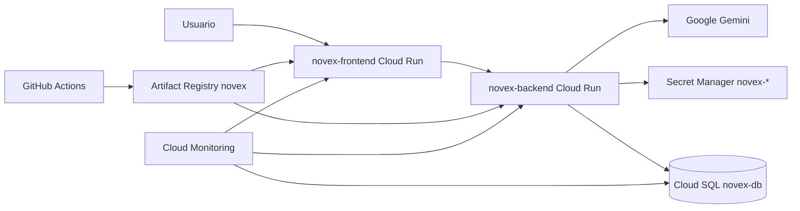

# Infraestructura GCP y operación de producción — NOVEX

Documento único de la plataforma en Google Cloud: arquitectura, CI/CD, monitoreo,
incidentes comunes, costos y planes aún no aplicados (ambientes y dominio propio).
Reúne lo que antes estaba repartido en `ARCHITECTURE.md`, `DEPLOY.md`, `MONITORING.md`,
`RUNBOOK.md`, `COSTOS.md`, `ENVIRONMENTS.md` y `CUSTOM-DOMAIN.md`.

Guías relacionadas (se conservan aparte):

| Documento | Para qué |
|---|---|
| [`../DEPLOY_BACKEND.md`](../DEPLOY_BACKEND.md) | Paso a paso Cloud Run del backend (IAM, Cloud SQL, secretos, build, rollback) |
| `NOVEX_FRONTEND/DEPLOY_FRONTEND.md` | Paso a paso Cloud Run del frontend (Vite, nginx, OAuth) |
| [SECRETS-AND-VARS.md](SECRETS-AND-VARS.md) | Nombres de secretos y variables (sin valores) |
| [SECURITY.md](SECURITY.md) | Cuenta de servicio, WIF, Artifact Registry, recomendaciones SQL |
| [BACKUP-DR.md](BACKUP-DR.md) · [RESTORE-TEST.md](RESTORE-TEST.md) | Backups, DR y prueba de restauración |
| [RELEASE_CIRCO.md](RELEASE_CIRCO.md) · [INCIDENTE-20261023-MIGRACIONES.md](INCIDENTE-20261023-MIGRACIONES.md) | Release Cartas y Circo y el incidente de migraciones |
| [`proyecto/despliegue-y-operacion.md`](proyecto/despliegue-y-operacion.md) | Puertas de migración pendientes (01B.1 → fusión de coordinaciones) |

---

## 1. Arquitectura de producción



| Componente | Recurso | Notas |
|---|---|---|
| Frontend | Cloud Run `novex-frontend` | nginx, 512Mi, CPU 1, concurrency 80 |
| Backend | Cloud Run `novex-backend` | NestJS, 1Gi, CPU 1, concurrency 40, Cloud SQL |
| Base de datos | Cloud SQL `novex-db` (Postgres 16) | ZONAL, `db-f1-micro`, backups ON |
| Secretos | `novex-db-password`, `novex-jwt-secret`, `novex-gemini-api-key` | Secret Manager |
| Imágenes | `us-central1-docker.pkg.dev/.../novex/` | Tags por SHA7 + digest |
| Auth UI | Google OAuth Client ID | Mismo ID en FE y BE |
| CI/CD | Workflows de cada repo | Validate → build → deploy → smoke |

- Proyecto: `it-fab-contenido-edu-5` · región `us-central1`.
- Cuenta de servicio runtime: la Compute por defecto (deuda: ver [SECURITY.md](SECURITY.md)).
- URLs: `https://novex-frontend-smazwcaz4a-uc.a.run.app` · `https://novex-backend-smazwcaz4a-uc.a.run.app`.
- Health: backend `/api/v1/auth/health` (y `/health`, `/health/ready`); frontend `/health` (nginx, responde `ok`).

## 2. CI/CD

| Repo | Workflow | Servicio |
|---|---|---|
| `NOVEX_BACKEND` | `.github/workflows/deploy-backend.yml` | `novex-backend` |
| `NOVEX_FRONTEND` | `.github/workflows/deploy-frontend.yml` | `novex-frontend` |

Disparo: push a `main` o `workflow_dispatch` (indicar `reason`). **Push a `main` = producción.**

1. **Validate** — `npm ci` + lint (+ typecheck FE) + tests + build.
2. **Build image** — tag `{sha7}`, labels OCI.
3. **Push** a Artifact Registry `novex/`.
4. **Deploy** — `gcloud run deploy --image=<digest>`, **solo imagen**.
5. **Smoke** — health HTTP obligatorio.

El deploy **no** pasa `--set-env-vars` / `--set-secrets` / `--add-cloudsql-instances`: así se preserva la
configuración viva de Cloud Run. **Ningún pipeline ejecuta migraciones**: migrar primero, desplegar después
(ver incidente del 23-oct).

### Rollback

```bash
gcloud run revisions list --service=novex-backend --region=us-central1
gcloud run services update-traffic novex-backend --region=us-central1 --to-revisions=REVISION_ANTERIOR=100
# o redesplegar un digest conocido
gcloud run deploy novex-backend --region=us-central1 \
  --image=REGION-docker.pkg.dev/PROJECT/novex/novex-backend@sha256:... --quiet
```

Tags de recuperación de versión: `novex-circo-prod-20261027`, `novex-pre-circo-20261023` (conservar siempre).

## 3. Monitoreo

- **Logging:** `gcloud logging read 'resource.type="cloud_run_revision" AND resource.labels.service_name="novex-backend"' --limit=50 --project=it-fab-contenido-edu-5`
- **Error Reporting:** habilitado; recoge errores no capturados de Cloud Run.
- **Uptime checks (60 s):** backend `/api/v1/auth/health`, frontend `/`.
- **Canal de notificación:** `NOVEX ops email` → `desarrollofabrica@cun.edu.co`.

| Alerta | Condición |
|---|---|
| Backend / frontend uptime down | Falla el uptime check |
| Cloud Run 5xx | Tasa 5xx elevada |
| Cloud Run CPU / memoria | p99 > 80 % / 85 % durante 5 min |
| Cloud SQL CPU | > 80 % durante 5 min |

Métricas clave: `run.googleapis.com/request_count` (por `response_code_class`), `container/cpu/utilizations`,
`container/memory/utilizations`, `cloudsql.googleapis.com/database/cpu/utilization`, `database/network/connections`.

## 4. Runbook de incidentes comunes

**Backend caído / 5xx**
1. Revisar alerta y uptime; `curl -fsS https://novex-backend-smazwcaz4a-uc.a.run.app/api/v1/auth/health`.
2. Logs en Cloud Logging (filtro `novex-backend`).
3. Estado de `novex-db` (CPU, conexiones, `RUNNABLE`).
4. Si coincide con un deploy: rollback de revisión (§2).

**Frontend en blanco**
1. `curl -fsS …/` y `curl -fsS …/health` (debe ser `ok`, no HTML).
2. Verificar que `VITE_API_BASE_URL` apunte a `novex-backend` (se hornea en el build).
3. Rollback de imagen frontend.

**Login Google falla**
1. Los *Authorized origins* de OAuth incluyen la URL usada.
2. `GOOGLE_CLIENT_ID` (BE) = `VITE_GOOGLE_CLIENT_ID` (FE).
3. `CORS_ORIGINS` del backend permite el origen del frontend.

**Base de datos / secretos**
1. Acceso a secretos solo desde cuenta autorizada; confirmar binding *accessor* de la SA runtime.
2. Corrupción de datos → restaurar **siempre a instancia nueva** ([BACKUP-DR.md](BACKUP-DR.md)).

**CI rojo**
1. Distinguir job Validate / Deploy / Smoke.
2. Si el smoke falla tras desplegar: no promover tráfico; rollback.
3. Variables de GitHub faltantes → fail-fast en el paso de metadatos.

## 5. Costos

Configuración actual: Cloud Run con `maxScale 5` y escala a cero; FE 512Mi; BE 1Gi/1 CPU; SQL `db-f1-micro` 10 GB;
Artifact Registry solo con tags SHA.

Ahorros posibles (sin aplicar): lifecycle de imágenes `novex-*` antiguas; retención de logs 30 días y
`DB_LOGGING=false` en prod; uptime cada 5 min si sube el costo; no activar HA de SQL hasta necesitarla;
revisar `startup-cpu-boost`; `CATALOG_SEED_ON_BOOT=false` en prod.
No bajar a ciegas: memoria del backend < 1Gi sin prueba de carga, ni `maxScale` en picos institucionales.

## 6. Planes no aplicados

### Ambientes DEV → STAGING → PROD (diseño)

| Aspecto | DEV | STAGING | PROD (hoy) |
|---|---|---|---|
| Proyecto GCP | `novex-dev` | `novex-staging` | `it-fab-contenido-edu-5` |
| Cloud Run | `*-dev` | `*-staging` | `novex-backend`, `novex-frontend` |
| Cloud SQL | pequeña / compartida | espejo reducido | `novex-db` |
| Secretos | `novex-dev-*` | `novex-staging-*` | `novex-*` |
| GitHub Environment | `development` | `staging` | `production` (con protección) |
| Datos | seed / anonimizados | subconjunto | reales |

Pasos: crear proyectos y APIs → clonar servicios desde YAML de prod → secretos por ambiente → GitHub
Environments → workflows con `environment:` → promoción por digest (staging → smoke → aprobación → prod).
Reglas: staging nunca apunta a `novex-db`; nunca secretos de prod fuera de prod; OAuth por ambiente.

### Dominio propio (procedimiento)

Objetivo: `novex.cun.edu.co` → `novex-frontend`, `api.novex.cun.edu.co` → `novex-backend`.
**No modificar DNS ni domain mappings sin autorización.**

1. `gcloud beta run domain-mappings create --service=<servicio> --domain=<host> --region=us-central1 --project=it-fab-contenido-edu-5`.
2. Publicar en la zona `cun.edu.co` los registros que indique el mapping; esperar certificado gestionado.
3. OAuth: añadir `https://novex.cun.edu.co` a origins/redirects (mantener `*.run.app` hasta el corte).
4. Backend: `CORS_ORIGINS` con el dominio nuevo (`gcloud run services update … --update-env-vars`).
5. Frontend: `VITE_API_BASE_URL=https://api.novex.cun.edu.co/api/v1` y redeploy.
6. Actualizar uptime checks y comunicar las URLs.
