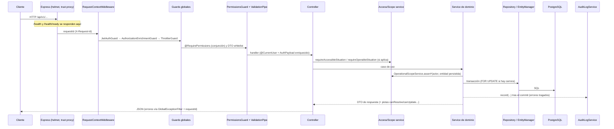

# Arquitectura del backend NOVEX

> **Propósito:** describir cómo arranca, se organiza y atiende peticiones el backend NestJS de NOVEX, qué módulos están activos y cuáles son latentes, para que quien continúe el sistema sepa dónde tocar y qué no romper.
> **Revisión:** 2026-11-06 · **Código de referencia:** NOVEX_BACKEND `5ffc65f` (producción = origin/main)
> **Leyenda:** [V] verificado en código · [H] histórico/documental · [?] no verificado · [I] inferido

Las reglas de negocio de situaciones están en [situaciones-y-reglas.md](situaciones-y-reglas.md). Permisos y alcance por rol están en [autenticacion-y-permisos.md](autenticacion-y-permisos.md). El esquema y las migraciones están en [base-de-datos-y-migraciones.md](base-de-datos-y-migraciones.md). Este documento no repite esos temas.

---

## 1. Pila y versiones [V]

| Pieza | Valor | Fuente |
|---|---|---|
| Framework | NestJS 11 (`@nestjs/core ^11.0.1`) sobre Express (`ExpressAdapter`) | `package.json`, [main.ts](../../src/main.ts) |
| ORM | TypeORM `^0.3.27` + `@nestjs/typeorm ^11.0.3`, PostgreSQL | `package.json`, [database.config.ts](../../src/configuration/database.config.ts) |
| Seguridad HTTP | `helmet ^8.3.0`, `@nestjs/throttler ^6.5.0` | `package.json` |
| Tareas programadas | `@nestjs/schedule ^6.1.3` (`ScheduleModule.forRoot()`) | [app.module.ts:68](../../src/app.module.ts) |
| IA | Gemini, ver [inteligencia-artificial.md](inteligencia-artificial.md) | — |

La versión de PostgreSQL en producción figura como 17 en [CLAUDE.md](../../CLAUDE.md) y como 16 en [ARCHITECTURE](../ARCHITECTURE.md) [H]. El código no la fija.

## 2. Arranque (`src/main.ts`) [V]

El arranque ocurre en dos fases. Primero se abre el puerto con Express puro, para que el startup probe de Cloud Run responda. Después se crea Nest sobre esa misma instancia de Express.

| Paso | Qué hace | Línea |
|---|---|---|
| 1 | `registerGlobalProcessHandlers()` y el estado de probes `ProbeHealthState` | [main.ts:23-26](../../src/main.ts) |
| 2 | `express()` con `trust proxy = 1`: `req.ip` toma `X-Forwarded-For`, de lo que depende el rate-limit. Desactiva `x-powered-by` | [main.ts:52-56](../../src/main.ts) |
| 3 | `helmet` con `contentSecurityPolicy: false` y `crossOriginEmbedderPolicy: false` (API JSON) | [main.ts:57-63](../../src/main.ts) |
| 4 | `registerProbeHealthRoutes`: `/health`, `/health/ready` y la ruta de compatibilidad `/api/v1/auth/health`, **fuera de Nest** | [main.ts:64](../../src/main.ts), [probe-health.ts:74-111](../../src/health/probe-health.ts) |
| 5 | `listenEarly(port)` en `0.0.0.0` (`PORT`, por defecto 3001) | [main.ts:28-33, 68](../../src/main.ts) |
| 6 | `verifyDatabaseConnection()`: preflight de PostgreSQL antes de cargar `AppModule` | [main.ts:72](../../src/main.ts) |
| 7 | Import dinámico de `AppModule` y `NestFactory.create(AppModule, new ExpressAdapter(expressApp))` | [main.ts:76-84](../../src/main.ts) |
| 8 | Prefijo global `apiPrefix` (config `API_PREFIX`, por defecto `api/v1`), que excluye `GET health` y `GET health/ready` | [main.ts:90-98](../../src/main.ts) |
| 9 | `ValidationPipe` global: `whitelist`, `forbidNonWhitelisted`, `transform` y `enableImplicitConversion` | [main.ts:99-106](../../src/main.ts) |
| 10 | CORS: `origin` = `resolveCorsOrigins()` y `credentials: true` | [main.ts:108-111](../../src/main.ts), [cors.config.ts](../../src/configuration/cors.config.ts) |
| 11 | `app.init()` y después `healthState.markNestReady(dataSource)`. Solo entonces `/health/ready` puede dar 200 | [main.ts:114-126](../../src/main.ts) |
| 12 | Si el arranque falla: `markBootstrapFailed(error)`. El proceso sigue vivo y `/health/ready` responde 503 con `failure.message` (hasta 500 caracteres) | [main.ts:133-136](../../src/main.ts), [probe-health.ts:31-50](../../src/health/probe-health.ts) |

**Probes** [V] ([probe-health.ts](../../src/health/probe-health.ts)):
- `GET /health`: siempre 200 `{status:'ok'}` (liveness).
- `GET /health/ready`: 200 `{status:'ready',checks:{database:'up'}}` solo si el `DataSource` está inicializado y `SELECT 1` responde. En otro caso, 503.
- `GET /api/v1/auth/health`: compatibilidad con el uptime check histórico. Usa la misma readiness.
- Riesgo ya registrado en [README](README.md) §6: el `failure.message` se expone sin autenticación.

**CORS** [V] ([cors.config.ts](../../src/configuration/cors.config.ts)): `CORS_ORIGINS` es una lista separada por comas. Cada origen se normaliza y se rechaza si trae ruta, query o fragmento. En `NODE_ENV=production` la variable es obligatoria (lanza error). Fuera de producción, si falta, se usan `http://localhost:5173` y `http://127.0.0.1:5173`. Pruebas: [cors.config.spec.ts](../../src/configuration/cors.config.spec.ts).

## 3. Composición de `AppModule` [V]

[app.module.ts](../../src/app.module.ts) importa la configuración, `ScheduleModule`, `ThrottlerModule.forRoot([THROTTLE_LIMITS.default])`, `CommonModule`, `AuditModule`, `TypeOrmModule.forRootAsync(typeOrmAsyncConfig)` y los módulos de dominio (líneas 63-118).

### 3.1 Guards globales (orden de registro) [V]

[app.module.ts:124-128](../../src/app.module.ts):

1. **`JwtAuthGuard`** ([jwt-auth.guard.ts](../../src/auth/guards/jwt-auth.guard.ts)): Passport `jwt`. Una ruta con `@Public()` lo salta. Sin usuario válido responde 401 `Sesión no válida.`
2. **`AuthorizationEnrichmentGuard`** ([authorization-enrichment.guard.ts](../../src/auth/guards/authorization-enrichment.guard.ts)): sustituye `request.user` por la autorización vigente en la base (`RbacService.resolveActiveAuthorization(sub)`). El JWT aporta solo la identidad; rol, coordinación y permisos se leen del servidor en cada petición.
3. **`ThrottlerGuard`**: límite por defecto de 600 peticiones por 60 s. Algunas rutas lo sobrescriben con `@Throttle`: autenticación 15/60 s y operaciones Gemini 10/60 s ([throttle.constants.ts](../../src/configuration/throttle.constants.ts)). No se configura ningún `storage`, así que el almacén es el de memoria por defecto, por instancia [I].

Además, cada controlador de dominio aplica **`PermissionsGuard`** (`@UseGuards(PermissionsGuard)`), que exige **todos** los permisos de `@RequirePermissions(...)` (conjunción) y responde 403 si falta alguno ([permissions.guard.ts](../../src/auth/guards/permissions.guard.ts)). La matriz de permisos por rol está en [autenticacion-y-permisos.md](autenticacion-y-permisos.md).

### 3.2 Middleware, interceptor y filtro globales [V]

| Pieza | Registro | Comportamiento |
|---|---|---|
| `RequestContextMiddleware` | `consumer.apply(...).forRoutes('{*path}')` ([app.module.ts:130-133](../../src/app.module.ts)) | Toma `x-request-id` entrante o genera un UUID. Lo guarda en `req.requestId`, lo devuelve en la cabecera `X-Request-Id` y abre un contexto (`RequestContextService.run`) ([request-context.middleware.ts](../../src/common/request-context/request-context.middleware.ts)) |
| `HttpLoggingInterceptor` | `APP_INTERCEPTOR` en [common.module.ts](../../src/common/common.module.ts) | Si `httpRequestLogging` está activo (por defecto solo en producción; variable `HTTP_REQUEST_LOGGING`), registra `http_request_completed` o `http_request_failed` en JSON con `requestId`, método, ruta, estado, duración y `userId` ([http-logging.interceptor.ts](../../src/common/logging/http-logging.interceptor.ts)) |
| `GlobalExceptionFilter` | `APP_FILTER` en [common.module.ts](../../src/common/common.module.ts) | Ver §7 |

Las rutas de probes (§2) **no** pasan por este middleware ni por los guards, porque están montadas en Express antes de Nest [I, por orden de registro en `main.ts`].

## 4. Módulos montados [V]

«Activo» significa que el módulo está importado en `AppModule` y tiene controladores registrados en su `*.module.ts`. «Interno» significa que está importado y no tiene controladores, pero sus servicios los consumen otros módulos. «Latente» significa que hay código sin rutas montadas. Todas las rutas llevan el prefijo `/api/v1`.

| Módulo | Controladores (rutas) | Servicios principales | Estado |
|---|---|---|---|
| `AuthModule` ([auth.module.ts](../../src/auth/auth.module.ts)) | `AuthController`: `POST /auth/google`, `POST /auth/email` (ambas `@Public`), `GET /auth/me` | `AuthService`, `JwtStrategy`, `OperationalScopeService` | Activo |
| `UsersModule` | `UsersController`: `PATCH /users/me/onboarding`, `GET/POST /users`, `GET /users/:id`, `GET /users/:id/permissions`, `PATCH /users/:id` | `UsersService`, `DevelopmentUserSeedService` | Activo |
| `RolesModule` | `RolesController`: `GET /roles`, `GET /roles/:id/permissions` | `RolesService`, `RoleCatalogSeedService` | Activo |
| `PermissionsModule` | `PermissionsController`: `GET /permissions` | `PermissionsService` | Activo |
| `RbacModule` | — | `RbacService` (lo usa el guard de enriquecimiento), `RolePermissionCatalogSeedService` | Interno |
| `CoordinationsModule` | `CoordinationsController`: `GET /coordinations`, `/coordinations/graph`, `/coordinations/network-status`, `/coordinations/:id` | `CoordinationsService`, `CoordinationCatalogSeedService` | Activo |
| `SituationsModule` ([situations.module.ts](../../src/situations/situations.module.ts)) | `SituationsController`: `GET /situations/categories`, `GET /situations`, `GET/PATCH /situations/:id`, `POST /situations/:id/resolution`, `POST /situations/:id/consequences`. `SituationSweepController`: `POST /internal/jobs/situation-sweep` | `SituationsService`, `SituationAccessService`, `SituationConsequencesService`, `SeverityEscalationService`, `SituationSweepService`, `SituationSlaScheduler`, `SchedulerOidcGuard` | Activo |
| `SituationTimelineModule` | `GET /situations/:id/timeline` | `SituationTimelineService`, `SituationTimelineSubscriber` (eventos `SITUATION_CREATED` y `UPDATED` por subscriber de TypeORM) | Activo |
| `SituationEvidenceModule` | `POST/GET /situations/:id/evidences`, `GET/DELETE /situations/:id/evidences/:evidenceId` | `SituationEvidenceService`, `EvidenceStorageService` | Activo |
| `SituationImpactModule` | `GET /situations/:id/impact`, `/affected-coordinations`, `/impact-context`, `POST /situations/:id/simulate-impact` | `SituationImpactService` | Activo |
| `SituationRecommendationsModule` | `GET/POST /situations/:id/recommendations`; `GET/PATCH /recommendations/:id` | `SituationRecommendationsService` | Activo (A1 corrige `/recommendations/:id`, ver [seguridad-y-correcciones.md](seguridad-y-correcciones.md)) |
| `AIOrchestrationModule` | `POST /situations/register-with-analysis`, `POST /situations/:id/analyze`, `GET /situations/:id/analysis` | `AIOrchestrator`, `GeminiProvider` | Activo |
| `AIAnalysisSessionsModule` | `GET /situations/:id/analysis/history`, `/analysis/history/:version`, `/analysis/compare` | `AIAnalysisSessionsService`, `AIAnalysisComparisonService` | Activo |
| `AIAnalysisModule`, `AIPromptEngineModule` | — | Parser, mapper y servicio de análisis; constructor de prompts | Interno |
| `OperationalOverviewModule` | `GET /operational-overview` | `OperationalOverviewService` (integridad y vidas) | Activo |
| `OperationalKpiModule` | `GET /operational-kpis`, `/state`, `/period`, `/breakdown`, `/relations`, `/history`, `/compare`, `/internal-problems`, `/internal-recurrence`, `/learnings`, `/learnings/items` | `OperationalKpiService` | Activo |
| `DashboardModule` | `GET /dashboard/metrics` | `DashboardService` | Activo |
| `AuditModule` | — | `AuditLogService` | Interno |
| `CommonModule` (global) | — | `RequestContextService`, interceptor, filtro | Interno |
| `ConfigurationModule` | — | `ConfigModule` global | Interno |
| `DatabaseSeedsModule` | — | `CatalogSeedService` y `DemoSeedService` (`onApplicationBootstrap`) | Interno, condicionado (ver §5.3) |

### 4.1 Código latente (sin rutas montadas) [V]

| Módulo | Situación | Prueba |
|---|---|---|
| `OperationalAreasModule` | Importado. `controllers: []`. Existe `operational-areas.controller.ts` (`GET/POST/PATCH /operational-areas`) **sin registrar** | [operational-areas.module.ts:9](../../src/operational-areas/operational-areas.module.ts) |
| `OperationalEventsModule` | Importado. `controllers: []`. El controlador `/operational-events` está sin registrar | [operational-events.module.ts:14](../../src/operational-events/operational-events.module.ts) |
| `RecommendedActionsModule` | Importado. `controllers: []`. El controlador `/recommended-actions` está sin registrar | [recommended-actions.module.ts:15](../../src/recommended-actions/recommended-actions.module.ts) |
| `IntelligenceModule` | Importado **sin clave `controllers`**: `IntelligenceController` (`/intelligence/*`) no se monta. **No se puede quitar sin más**: registra con `forFeature` la entidad `IncidentCategory`, que usan las categorías de situaciones | [intelligence.module.ts](../../src/intelligence/intelligence.module.ts) |
| `DemoUsersModule` | **No importado** en `AppModule`. Su controlador declararía `POST /users/ensure` y `PATCH /users/:id/onboarding/complete` | [app.module.ts](../../src/app.module.ts) (no figura en `imports`) |

Retirar este código es la tarea pendiente n.º 9 del [README](README.md). Antes conviene comprobar las dependencias entre módulos (`forwardRef` en `IntelligenceModule`) [I].

## 5. Configuración [V]

### 5.1 Carga y validación

- `ConfigModule.forRoot({ isGlobal, load: [configuration], validate: validateEnvironment, envFilePath: ['.env.local', '.env'] })` ([configuration.module.ts](../../src/configuration/configuration.module.ts)).
- `configuration()` construye el objeto tipado: `nodeEnv`, `port`, `apiPrefix`, `database.*`, `gemini.*`, `jwt.*`, `google.clientId`, `situationSweep.*`, `enableEmailLogin` y `httpRequestLogging` ([configuration.ts](../../src/configuration/configuration.ts)).
- `validateEnvironment` usa class-validator sobre `EnvironmentVariables` ([env.validation.ts](../../src/configuration/env.validation.ts)). La resolución de la base pasa por `resolveDatabaseEnv` (perfil local o cloud según `DB_CLOUD`) ([resolve-database-env.ts](../../src/configuration/resolve-database-env.ts); pruebas en [resolve-database-env.spec.ts](../../src/configuration/resolve-database-env.spec.ts)).

### 5.2 Variables (solo nombres)

| Grupo | Variables | Obligatoria según `env.validation.ts` |
|---|---|---|
| Proceso | `NODE_ENV`, `PORT`, `API_PREFIX` | No (con default) |
| HTTP | `CORS_ORIGINS` (obligatoria en producción por `cors.config.ts`), `HTTP_REQUEST_LOGGING` | No |
| Base de datos | `DB_CLOUD`, `DB_HOST`, `DB_PORT`, `DB_USERNAME`, `DB_PASSWORD`, `DB_DATABASE`, `DB_SSL`, `DB_LOGGING`, `DB_SYNCHRONIZE` (obsoleta: se ignora, `synchronize` es siempre `false`) | `DB_HOST`, `DB_USERNAME`, `DB_PASSWORD`, `DB_DATABASE` |
| Auth | `JWT_SECRET`, `JWT_EXPIRES_IN`, `GOOGLE_CLIENT_ID`, `ENABLE_EMAIL_LOGIN` | `JWT_SECRET`, `GOOGLE_CLIENT_ID` |
| IA | `GEMINI_API_KEY`, `GEMINI_MODEL`, `GEMINI_TIMEOUT_MS`, `GEMINI_BASE_URL` (solo fuera de producción), `GEMINI_THROTTLE_LIMIT` (solo fuera de producción) | No |
| Barrido | `SITUATION_SWEEP_CRON_ENABLED` (default `true`), `SEVERITY_ESCALATION_ENABLED` (default `false`), `SCHEDULER_OIDC_AUDIENCE`, `SCHEDULER_OIDC_SERVICE_ACCOUNT_EMAIL` | No |
| Seeds | `CATALOG_SEED_ON_BOOT`, `DEMO_SEED_ENABLED` | No |

Dónde viven los secretos y cómo se inyectan en Cloud Run: [despliegue-y-operacion.md](despliegue-y-operacion.md) y [SECRETS-AND-VARS](../SECRETS-AND-VARS.md).

### 5.3 Seeds al arrancar

`isCatalogSeedEnabled()` habilita los seeds de catálogo (coordinaciones, roles, permisos) por defecto fuera de producción y los deshabilita en producción, salvo que `CATALOG_SEED_ON_BOOT` lo fuerce ([catalog-seed.guard.ts](../../src/configuration/catalog-seed.guard.ts)). `DemoSeedService` solo avisa si ve `DEMO_SEED_ENABLED=true`: según su mensaje, permanece deshabilitado ([demo-seed.service.ts](../../src/database/seeds/demo-seed.service.ts)).

## 6. Persistencia (visión general) [V]

- **Runtime Nest:** `typeOrmAsyncConfig` con `type: 'postgres'`, `autoLoadEntities: true`, **`synchronize: false`**, **`migrationsRun: false`**, `migrationsTableName: 'typeorm_migrations'` y `migrationsTransactionMode: 'each'`. Los reintentos son 6×3 s en producción y 5×2 s fuera. SSL con `rejectUnauthorized: false` si `database.ssl` ([database.config.ts](../../src/configuration/database.config.ts)).
- **CLI de migraciones:** [data-source.ts](../../src/database/data-source.ts) con las mismas opciones (entidades por glob `**/*.entity`). **El arranque nunca aplica migraciones.** Se aplican a mano; procedimiento en [base-de-datos-y-migraciones.md](base-de-datos-y-migraciones.md).
- **Acceso a datos:** combina `@InjectRepository(Entidad)` con repositorios propios por módulo (`*/repositories/*.repository.ts`, p. ej. [situations.repository.ts](../../src/situations/repositories/situations.repository.ts)).
- **Transacciones:** las escrituras críticas usan `manager.transaction(...)` con `pessimistic_write` sobre la fila de la situación (resolución y afectaciones). Las situaciones cargan `coordination`, `createdByUser`, `assignedUser` y `category` como relaciones `eager`, y por eso los `FOR UPDATE` usan `loadEagerRelations: false` ([situations.service.ts:918-935](../../src/situations/situations.service.ts)).
- **SQL directo:** el barrido usa `UPDATE … FOR UPDATE SKIP LOCKED` y `pg_try_advisory_xact_lock`; el reclamo de análisis IA usa `UPDATE` condicionales ([situation-sweep.service.ts](../../src/situations/sweep/situation-sweep.service.ts), [ai-orchestrator.service.ts:472-495](../../src/ai-orchestration/ai-orchestrator.service.ts)).
- **Invariantes en la base:** triggers append-only en `situation_severity_changes` y `situation_consequences`, índices únicos parciales y CHECK. Detalle en [base-de-datos-y-migraciones.md](base-de-datos-y-migraciones.md).

## 7. Convenciones de error y respuesta [V]

**Filtro global** ([global-exception.filter.ts](../../src/common/filters/global-exception.filter.ts)):
- `HttpException`: devuelve el cuerpo original de Nest con `requestId` añadido. Si el cuerpo es un string, se envuelve como `{ statusCode, message, requestId }`.
- Cualquier otro error: 500 `{ statusCode: 500, message: 'Error interno del servidor.', requestId }`. No se filtra el detalle.
- Los 5xx se registran como `unhandled_exception` (JSON estructurado, sin cuerpo de la petición).

**Errores de validación:** el `ValidationPipe` responde 400 con `message` como **array** de textos. Un campo no declarado en el DTO también da 400 (`forbidNonWhitelisted`) [V en main.ts; formato exacto según el comportamiento estándar de Nest, I].

**Códigos de negocio con `code`** (cuerpo `{ code, message, ... }`) [V]:

| Código | HTTP | Origen |
|---|---|---|
| `LEGACY_REGISTRATION_REQUIRES_COORDINATION` | 400 | [situations.service.ts:224-230](../../src/situations/situations.service.ts) |
| `IDEMPOTENCY_KEY_REUSED` | 422 | [ai-orchestrator.service.ts:558-564](../../src/ai-orchestration/ai-orchestrator.service.ts) |
| `REGISTRATION_IN_PROGRESS` | 409 | [ai-orchestrator.service.ts:577-583](../../src/ai-orchestration/ai-orchestrator.service.ts) |
| `ANALYSIS_IN_PROGRESS`, `ANALYSIS_CLAIM_LOST` | 409 | [ai-orchestrator.service.ts:486-492, 527-533](../../src/ai-orchestration/ai-orchestrator.service.ts) |

**Semántica 404 frente a 403 (convención de alcance)** [V]: una situación fuera del alcance de lectura de un actor acotado por coordinación responde **404** (`Situación no encontrada.`), para no revelar que existe ([operational-scope.service.ts:81-94](../../src/auth/services/operational-scope.service.ts)). Si el actor puede leer el caso y la operación no le corresponde, responde **403** con un mensaje de negocio. Los conflictos de estado (caso ya cerrado) responden **409**.

**Respuestas:** sin envoltorio común. Cada controlador devuelve el DTO de su servicio. Los `POST` responden 201 (default de Nest), salvo `POST /internal/jobs/situation-sweep`, que usa `@HttpCode(200)` ([situation-sweep.controller.ts:35](../../src/situations/sweep/situation-sweep.controller.ts)). Los listados paginados devuelven `{ items, total, page, limit }`, con `limit` de 50 por defecto y 100 como máximo ([pagination-query.dto.ts](../../src/common/dto/pagination-query.dto.ts)).

**Auditoría:** `AuditLogService.record` se llama **después** del commit y captura sus propios errores: si falla, solo lo registra en el log y la operación de negocio no se revierte ([audit-log.service.ts:27-45](../../src/audit/audit-log.service.ts)). Riesgo documentado en [README](README.md) §6.

## 8. Flujo general de una petición [V/I]



Puntos clave:
- La **autorización fina** (quién opera qué situación) **no** está en los guards. Está en `OperationalScopeService` ([operational-scope.service.ts](../../src/auth/services/operational-scope.service.ts)), que el servicio invoca contra la entidad **persistida**, nunca contra datos del cliente.
- `SituationAccessService` ([situation-access.service.ts](../../src/situations/situation-access.service.ts)) es la puerta común de los submódulos (`evidences`, `timeline`, `impact`, `recommendations`, `analysis`). `requireAccessibleSituation` exige lectura. `requireOperableSituation` exige lectura, alcance de coordinación y propiedad del caso.
- Las pistas `canResolve`, `canAdvanceToInProgress`, `canUpdate` y `canAddConsequence` de las respuestas se calculan con las mismas políticas, pero **no autorizan**: cada escritura vuelve a comprobarlas ([situations.service.ts:1283-1366](../../src/situations/situations.service.ts)).

## 9. Convenciones de carpetas [V]

```
src/
  main.ts, app.module.ts
  <dominio>/
    <dominio>.module.ts         # importado en AppModule
    <dominio>.controller.ts     # @Controller + @UseGuards(PermissionsGuard)
    <dominio>.service.ts        # reglas de negocio y transacciones
    dto/                        # class-validator (entrada) y clases de respuesta
    entities/                   # TypeORM (@Entity), nombres snake_case en BD
    repositories/               # consultas propias (QueryBuilder)
    domain/                     # funciones puras (p. ej. operational-overview/domain)
    *.spec.ts                   # pruebas unitarias junto al código
    *.pg.spec.ts                # pruebas que requieren PostgreSQL real
  common/   enums/, filters/, logging/, request-context/, dto/, utils/
  configuration/   configuración, validación de env, CORS, throttling
  database/   data-source.ts, migrations/, seeds/
test/   e2e (*.e2e-spec.ts), security/, integration/ (*.int-spec.ts), audit/, observability/
```

- Enums de dominio compartidos: `src/common/enums/` (p. ej. [situation.enums.ts](../../src/common/enums/situation.enums.ts)).
- Las políticas versionadas tienen código explícito: `severity-v1` (SLA), `integrity-mvp-v1` y `life-points-v1`.
- Los comentarios del código son extensos y explican el porqué. Antes de cambiar una regla, conviene leer el bloque de comentario que la precede.
- Cómo ejecutar cada suite: [pruebas-y-desarrollo.md](pruebas-y-desarrollo.md).

## 10. Discrepancias con documentación previa

| Documento | Afirma | Código |
|---|---|---|
| [README del repo](../../README.md) §Flujos | `register-with-analysis` persiste y **orquesta el análisis Gemini** | El alta ya no llama a Gemini: devuelve `analysis: null` y el análisis va aparte con `POST :id/analyze` ([ai-orchestrator.service.ts:108-178](../../src/ai-orchestration/ai-orchestrator.service.ts)) [V] |
| [README del repo](../../README.md) §API | Rutas `/operational-events`, `/operational-areas`, `/intelligence`, `/recommended-actions` | Ninguna está montada (§4.1) [V] |
| [ARCHITECTURE](../ARCHITECTURE.md) | Health del backend en `/api/v1/auth/health` | Las probes autoritativas son `/health` y `/health/ready`. La ruta antigua es solo compatibilidad [V] |
| Comentario en [situation-sweep.service.ts:70-72](../../src/situations/sweep/situation-sweep.service.ts) | Cloud Scheduler «cada 15 min» como fuente confiable | Scheduler no configurado según [RELEASE_CIRCO](../RELEASE_CIRCO.md) §8 [H]. El `@Cron` en proceso corre cada 30 min [V] |

## Límites de verificación

- Todo lo anterior se verificó **por lectura de código** en `5ffc65f`. No se ejecutó la aplicación, ni pruebas, ni build, ni lint.
- No se verificó la configuración real de Cloud Run (variables, `min-instances`, número de instancias) [?]. Por eso el efecto del throttler en memoria con varias instancias y la ejecución efectiva del `@Cron` siguen siendo [I] o [?].
- El formato exacto de los errores de validación se infiere del comportamiento estándar de Nest; no se capturó una respuesta real.
- No se revisaron a fondo los módulos `coordinations`, `dashboard`, `operational-kpis`, `situation-evidence` ni `situation-impact`. La tabla del §4 lista sus rutas a partir de los decoradores, no de su lógica.

## Documentos relacionados

- [README.md](README.md): índice del empalme, estado de producción y riesgos.
- [situaciones-y-reglas.md](situaciones-y-reglas.md): reglas de negocio de situaciones.
- [autenticacion-y-permisos.md](autenticacion-y-permisos.md): JWT, RBAC, matriz de permisos y alcance.
- [base-de-datos-y-migraciones.md](base-de-datos-y-migraciones.md): esquema, las 26 migraciones y su procedimiento.
- [seguridad-y-correcciones.md](seguridad-y-correcciones.md): A1, A2, M1, N1 y N2.
- [inteligencia-artificial.md](inteligencia-artificial.md): Gemini, prompts y análisis.
- [despliegue-y-operacion.md](despliegue-y-operacion.md): CI/CD, Cloud Run, variables y secretos.
- [pruebas-y-desarrollo.md](pruebas-y-desarrollo.md): suites y entorno local.
- [CLAUDE.md](../../CLAUDE.md): reglas de trabajo con el asistente.
- Frontend: NOVEX_FRONTEND → `docs/empalme/README.md`.
