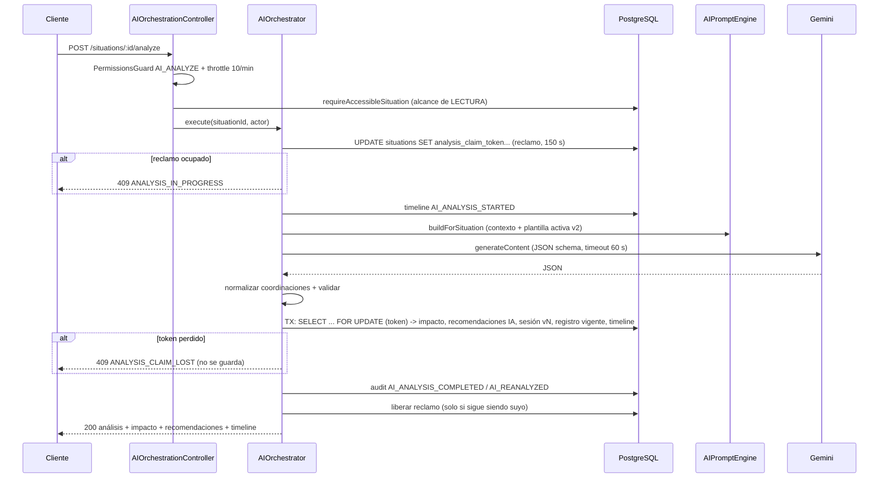

# Inteligencia artificial en NOVEX

> **Propósito:** describir con precisión la IA que existe hoy en el backend (análisis de situaciones con Gemini) y dejar delimitado, sin implementarlo, lo que haría falta para un asistente conversacional futuro.
> **Revisión:** 2026-11-06 · **Código de referencia:** NOVEX_BACKEND `5ffc65f` (producción = origin/main)
> **Leyenda:** [V] verificado en código · [H] histórico/documental · [?] no verificado · [I] inferido

**Aclaración previa.** Claude Opus 5.5 es el **asistente de desarrollo** del equipo (escribe y revisa código en este repositorio). **No forma parte de NOVEX** ni es su proveedor de IA. La IA de NOVEX en producción es Google Gemini [V]. El proveedor de un asistente futuro **no está decidido** y este documento no asume que vaya a ser Claude.

---

# PARTE 1 — IA existente

## 1.1 Resumen

| Aspecto | Estado en `5ffc65f` |
|---|---|
| Única capacidad de IA | Análisis estructurado de **una** situación, bajo petición explícita (`POST /situations/:id/analyze`) [V] |
| Proveedor | Google Gemini vía SDK `@google/genai` ([gemini.provider.ts](../../src/ai-orchestration/providers/gemini.provider.ts)) [V] |
| Análisis en el alta | **Desactivado**: `register-with-analysis` ya no llama a Gemini y responde `analysis: null` [V] |
| Asistente conversacional | **No existe** (ni código ni documentación de diseño en el repo) [V] |
| Módulo legado `src/intelligence/` | Usa el SDK antiguo `@google/generative-ai`; su controlador **no está montado** [V] |
| Uso desde la UI de producción | Solo UI heredada o latente; no hay UI de IA montada en producción [H] (ver NOVEX_FRONTEND → `docs/empalme/contratos-api.md`) |

## 1.2 Módulos

| Módulo | Ruta | Responsabilidad |
|---|---|---|
| `AIOrchestrationModule` | `src/ai-orchestration/` | Controlador HTTP, orquestador, proveedor Gemini, registro vigente (`situation_ai_analysis_records`) |
| `AIPromptEngineModule` | `src/ai-prompt-engine/` | Construcción del contexto, plantillas v1/v2/v3, validador y métricas del prompt |
| `AIAnalysisModule` | `src/ai-analysis/` | Contrato `AIAnalysisResult`, esquema JSON de respuesta, parser, mapper a impacto/recomendaciones/timeline, persistencia |
| `AIAnalysisSessionsModule` | `src/ai-analysis-sessions/` | Historial versionado (`situation_analysis_sessions`), endpoints de historial y comparación |
| `IntelligenceModule` (legado) | `src/intelligence/` | Interpretación de eventos operacionales con el SDK antiguo; sin rutas |

Los cuatro primeros y `IntelligenceModule` se importan en `src/app.module.ts` (líneas 92–106) [V].

## 1.3 Proveedor Gemini

Archivo: [gemini.provider.ts](../../src/ai-orchestration/providers/gemini.provider.ts) [V]

- Cliente `new GoogleGenAI({ apiKey, httpOptions?: { baseUrl } })` (l. 79–82). Un cliente por llamada.
- Llamada `client.models.generateContent` (l. 92–102) con:
  - `systemInstruction` = prompt de sistema; `contents` = prompt de usuario;
  - `temperature: 0.2`;
  - `responseMimeType: 'application/json'` y `responseJsonSchema: AI_ANALYSIS_RESPONSE_JSON_SCHEMA` (`src/ai-analysis/schemas/ai-analysis-response.schema.ts`).
- **Timeout:** `executeWithAbortTimeout` con `AbortSignal` (l. 90–104). Al vencer → `GatewayTimeoutException` (**504**) vía `toGatewayTimeoutException` (`src/common/utils/abort-timeout.ts`). Valor: `gemini.timeoutMs`, por defecto 60 000 ms (l. 207–213).
- **Otros fallos del proveedor** → 503 `No fue posible completar el análisis IA.` (l. 126). Sin `GEMINI_API_KEY` → 503 (l. 70–74). Respuesta vacía → 503 (l. 132–141).
- **`parseWithRetry`** (l. 156–182): parsea; si falla, reintenta **una vez** quitando cercas Markdown ```` ``` ````. No vuelve a llamar al modelo. Si falla de nuevo → 503.
- **Modelo:** `gemini.model`, por defecto `gemini-3-flash-preview` (l. 200–205; también `src/configuration/configuration.ts` l. 32). En producción se fija con la sustitución `_GEMINI_MODEL: gemini-3-flash-preview` de `cloudbuild.backend.yaml` (l. 23) [V].
- Registra eventos estructurados `gemini_analysis_timeout | provider_failure | empty_response | validation_failure | success` con `requestId`, `situationId` y `model`; **no registra el contenido** del prompt ni de la respuesta [V].
- `health()` solo comprueba que haya clave; no llama a la API [V].

Detalle menor [V]: `getModel()` usa `?.trim() ?? default`; si `GEMINI_MODEL` existiera como cadena vacía, el resultado sería `''` y no el valor por defecto. La validación de entorno (`src/configuration/env.validation.ts` l. 90) da un valor por defecto, por lo que en la práctica es improbable [I].

## 1.4 Flujo de orquestación

Archivo: [ai-orchestrator.service.ts](../../src/ai-orchestration/ai-orchestrator.service.ts) [V]



Puntos clave [V]:

- **Alta sin IA.** `registerAndExecute` (l. 130–179) solo crea la situación (con idempotencia por `Idempotency-Key` UUID v4) y `newRegistrationResponse` devuelve `{ situation, analysis: null, replayed: false }` (l. 241–248). El replay con la misma clave es de solo lectura y nunca llama a Gemini (l. 548–575); si alguien analizó después, devuelve ese análisis.
- **Reclamo con arrendamiento.** `ANALYSIS_CLAIM_LEASE_MS = 150_000` (l. 67). `claimAnalysis` es un único `UPDATE` condicional sobre `analysis_claim_token` / `analysis_claim_expires_at` (l. 472–495). Si no gana → 409 `ANALYSIS_IN_PROGRESS`.
- **Confirmación fenciada.** Dentro de la transacción de persistencia, `assertClaimHeld` hace `SELECT ... FOR UPDATE` por token (l. 514–534); si el token ya no es suyo → 409 `ANALYSIS_CLAIM_LOST` y no se escribe nada. La llamada a Gemini queda **fuera** de la transacción (comentario l. 297–298).
- **Liberación** en `finally`, condicionada al token (l. 498–508).
- **Fallo** (l. 411–465): escribe timeline `AI_ANALYSIS_FAILED` y auditoría `AI_ANALYSIS_FAILED`; no borra la situación. La pérdida de reclamo (409) no se registra como fallo de IA.

## 1.5 Qué escribe un análisis

Todo en la transacción fenciada salvo lo indicado [V]:

| Escritura | Dónde | Notas |
|---|---|---|
| Timeline `AI_ANALYSIS_STARTED` | `ai-orchestrator.service.ts` l. 258–274 | **Antes** de llamar a Gemini y fuera de la transacción; metadatos `provider`, `claimToken` |
| Evaluación de impacto | `AIAnalysisService.persistAnalysis` (`src/ai-analysis/ai-analysis.service.ts` l. 66–109) | Reemplaza la existente (`replaceAssessment`) o la crea |
| Recomendaciones IA | `SituationRecommendationsService.createAIRecommendations` | **Se añaden** filas nuevas `generatedBy = AI`, `status = PENDING` en cada análisis; no se retiran las anteriores [V en `createAIRecommendations`; efecto acumulativo I] |
| Timeline del mapper (`AI_ANALYZED`, etc.) | `src/ai-analysis/mappers/ai-analysis.mapper.ts` l. 119+ | Descripción = `executiveSummary.headline` |
| Sesión versionada `vN` | `situation_analysis_sessions` | `version = última + 1`; guarda `prompt_snapshot` completo |
| Registro vigente | `situation_ai_analysis_records` | Un registro por situación con `current_session_id` y `analysis_result` |
| Timeline `AI_ANALYSIS_VERSION_CREATED` y, si había versión previa, `AI_REANALYZED` | orquestador l. 329–361 | |
| Auditoría `AI_ANALYSIS_COMPLETED` o `AI_REANALYZED` | orquestador l. 374–388 | Fuera de la transacción. `AuditLogService.record` traga errores ([seguridad-y-correcciones.md](seguridad-y-correcciones.md)) |

La evaluación de impacto alimenta la integridad de las cartas [H: comentario de M1 en `_m1`]; por eso analizar es, en la práctica, una **escritura** con efectos de negocio.

## 1.6 Prompts y versiones

Archivo: [prompt-template.registry.ts](../../src/ai-prompt-engine/templates/prompt-template.registry.ts) [V]

| Versión | `id` | Rol de sistema | Activa |
|---|---|---|---|
| v1 | `operational-analysis` | «analista de inteligencia operacional de NOVEX» | No (legada) |
| **v2** | `operational-intelligence-v2` | «Director de Inteligencia Operacional de NOVEX… como un comité ejecutivo» | **Sí** (`isActive: true`) |
| v3 | `operational-analysis-impact` | v1 + énfasis en impacto y propagación | No |

- `getActivePromptTemplate()` devuelve la que tiene `isActive`; si ninguna, v2 (l. 191–197).
- `PromptBuilder` (`src/ai-prompt-engine/builders/prompt.builder.ts`) arma: sistema; usuario = bloque CONTEXTO con el **expediente completo en JSON** (`JSON.stringify(context)`, l. 36–43) + INSTRUCCIONES con la lista cerrada de códigos de coordinación y categoría permitidos (l. 45–72).
- `PromptValidator` produce solo **advertencias** (`valid`, `warnings`) y `PromptMetricsCalculator` estima tokens (caracteres / constante). El orquestador **no bloquea** por la validación: el resultado no se consulta fuera del motor [V].
- Las plantillas piden no inventar datos (l. 18, 70) pero **no** contienen instrucciones contra inyección de prompt desde el texto del expediente [V].
- La salida está acotada por el esquema JSON, el parser y `normalizeCoordinationReferences`, que filtra coordinaciones no válidas (`ai-analysis.mapper.ts` l. ~95–107) [V].

## 1.7 Datos enviados al modelo (privacidad)

`SituationContextBuilder.buildOperationalContext` (`src/ai-prompt-engine/builders/situation-context.builder.ts`) [V]:

| Bloque | Campos | Líneas |
|---|---|---|
| `situation` | id, **título, descripción**, severidad, estado, fechas | 207–218 |
| `createdBy` | id, **nombre completo, correo electrónico**, coordinationId del autor | 69–74 |
| `originCoordination`, `availableCoordinations`, `category`, `availableCategories` | catálogos (id, código, nombre) | 75–102 |
| `timeline` | tipo, título, descripción, **nombre del usuario**, `metadata` (incluye p. ej. `claimToken`), fecha | 118–132 |
| `evidences` | tipo, **título, descripción**, nombre de archivo, mime, tamaño, **nombre de quien subió** | 134–149 |
| `existingRecommendations` | título, descripción, prioridad, estado, **nombre del asignado**, fechas | 151–167 |
| `previousAssessment` | evaluación de impacto anterior | 169–196 |

- **No** se envía el contenido binario de archivos de evidencia (solo metadatos) [V].
- Se envían **datos personales** (nombres y correo del autor) y **texto libre** escrito por usuarios [V]. No hay minimización ni seudonimización.
- El prompt completo (con esos datos) se **persiste** en `situation_analysis_sessions.prompt_snapshot` y se **devuelve** por `GET /situations/:id/analysis/history/:version` (`ai-analysis-sessions.service.ts` l. 40, 131) a quien tenga `AI_VIEW_REPORTS` y alcance de lectura [V].
- Condiciones contractuales/retención de datos del lado de Google: [?] no hay documento en el repo.

## 1.8 Endpoints

Prefijo global `api/v1` (`API_PREFIX`, `src/main.ts` l. 91–93; `_API_PREFIX: api/v1` en `cloudbuild.backend.yaml`) [V]. Todas pasan por los guards globales (JWT + enriquecimiento de autorización desde BD) y `PermissionsGuard`.

| Método | Ruta | Permiso | Alcance comprobado | Throttle | Fuente |
|---|---|---|---|---|---|
| POST | `/situations/register-with-analysis` | `SITUATIONS_CREATE` | Regla de creación del servicio de situaciones | 10/min | `ai-orchestration.controller.ts` l. 34–69 |
| POST | `/situations/:id/analyze` | `AI_ANALYZE` | **Lectura** (`requireAccessibleSituation`) — ver §1.9 | 10/min | l. 71–88 |
| GET | `/situations/:id/analysis` | `AI_VIEW_REPORTS` | Lectura | global 600/min | l. 90–101 |
| GET | `/situations/:id/analysis/history` | `AI_VIEW_REPORTS` | Lectura | global | `ai-analysis-sessions.controller.ts` l. 41–52 |
| GET | `/situations/:id/analysis/history/:version` | `AI_VIEW_REPORTS` | Lectura | global | l. 54–66 (incluye `promptSnapshot`) |
| GET | `/situations/:id/analysis/compare?fromVersion&toVersion` | `AI_VIEW_REPORTS` | Lectura | global | l. 68–84 |

Throttle: `THROTTLE_GEMINI_LIMIT` = 10 por ventana de 60 s; en producción siempre 10; fuera de producción ajustable con `GEMINI_THROTTLE_LIMIT` (`src/configuration/throttle.constants.ts` l. 14–29). El throttler es en memoria por instancia [I, ver README de empalme].

Reparto de permisos (`src/permissions/seeds/permissions.catalog.seed.ts` l. 127–197) [V]:

| Rol | `AI_ANALYZE` | `AI_VIEW_REPORTS` |
|---|---|---|
| ANALISTA | Sí | Sí |
| COORDINADOR | Sí | Sí |
| DIRECTOR | No | Sí |
| ADMIN | No | Sí (hereda todo salvo operación de situaciones y `KPIS_VIEW`) |

## 1.9 Autorización y brecha M1

- Fuera de alcance → **404** (`NotFoundException`), no 403 (`operational-scope.service.ts` l. 81–93) [V].
- `requireAccessibleSituation` (`src/situations/situation-access.service.ts` l. 14–31) aplica `assertSituationReadable`: alcance de coordinación **o** autoría propia **o** coordinación afectada (INTER) (`operational-scope.service.ts` l. 126–155) [V].
- **Brecha M1** [V en código, sin prueba de explotación]: `POST :id/analyze` es una escritura (§1.5) pero usa el alcance de **lectura**. Consecuencias: un COORDINADOR puede analizar casos de otra área en los que es afectado o autor; un ANALISTA (no acotado por coordinación) puede analizar cualquier caso que lea; y se puede analizar una situación **cerrada**.
- **Corrección pendiente (sin commit)** en el worktree `NOVEX_BACKEND_m1`: cambia a `requireOperableSituation` y devuelve **409 `SITUATION_CLOSED`** para casos cerrados, antes de tomar el reclamo o llamar a Gemini; añade `test/security/m1-situation-writes-scope.spec.ts`. Requiere decisión de producto (política P1). Detalle en [seguridad-y-correcciones.md](seguridad-y-correcciones.md).
- Los GET de análisis siguen con alcance de lectura, lo cual es coherente con su naturaleza [V].

## 1.10 Funciones inactivas o inexistentes

| Elemento | Estado |
|---|---|
| Análisis automático en el alta | Desactivado (comentario `ai-orchestrator.service.ts` l. 108–129). El nombre de la ruta `register-with-analysis` se mantiene por compatibilidad [V] |
| `GeminiProvider.analyzeSituation` | Implementado (l. 58–63) pero el orquestador usa `executeAnalysis`; fuera de pruebas no hay llamadores de `analyzeSituation` (solo su declaración en `ai-provider.contract.ts`) [V por búsqueda] |
| `src/intelligence/` | `IntelligenceController` (`@Controller('intelligence')`) **no** está en `controllers` de ningún módulo; `IntelligenceModule` solo exporta servicios. SDK `@google/generative-ai` (`gemini.service.ts` l. 7). Su prompt dice «NO eres un chatbot ni un asistente general» (`src/intelligence/gemini/prompt.builder.ts` l. 15). `IncidentCategory` sí se usa (catálogo de categorías) [V] |
| «Resumen ejecutivo» como función propia | No existe endpoint ni servicio. Solo existe el **campo** `executiveSummary` dentro de `AIAnalysisResult` (`src/ai-analysis/contracts/ai-analysis-result.contract.ts` l. 13–17) y el contrato legado `ExecutiveIntelligenceReport` en `src/intelligence/` [V] |
| Asistente conversacional | No existe [V] |

## 1.11 Configuración

| Variable | Uso | Producción |
|---|---|---|
| `GEMINI_API_KEY` | Clave del proveedor | Secret Manager (`novex-gemini-api-key`, `cloudbuild.backend.yaml` l. 102) [V] |
| `GEMINI_MODEL` | Modelo (defecto `gemini-3-flash-preview`) | Variable de Cloud Run [V] |
| `GEMINI_TIMEOUT_MS` | Timeout por llamada (defecto 60 000) | No se fija en `cloudbuild.backend.yaml` → defecto [V] |
| `GEMINI_BASE_URL` | Apuntar a un stub | **Ignorada** con `NODE_ENV=production` (`configuration.ts` l. 34–38) [V] |
| `GEMINI_THROTTLE_LIMIT` | Cupo de IA por ventana | **Ignorada** en producción (`throttle.constants.ts` l. 24) [V] |

Si se sube el timeout por encima de ~90 s, hay que subir `ANALYSIS_CLAIM_LEASE_MS` (comentario l. 61–66) [V].

---

# PARTE 2 — Asistente conversacional futuro (NO implementado)

> Nada de esta parte existe en el código. Es una guía de diseño para quien lo construya.

## 2.1 Objetivo previsto

Según notas de sesión del equipo [H]: un asistente de **solo lectura** que responda preguntas sobre situaciones, KPIs y estado operativo **respetando los permisos y el alcance efectivos** de quien pregunta. Las correcciones A1 y A2 se motivaron en parte por ese objetivo: un asistente expondría cualquier fuga de alcance de las rutas que reutilice [H].

## 2.2 Componentes reutilizables (existen hoy)

| Componente | Ruta | Para qué |
|---|---|---|
| `RbacService.resolveActiveAuthorization` | `src/rbac/rbac.service.ts` l. 74 | Permisos vigentes desde BD por petición |
| Guards globales (`jwt-auth`, `authorization-enrichment`, `permissions`) | `src/auth/guards/` | Autenticación y permiso por ruta |
| `OperationalScopeService` (`assertSituationReadable`, `assertSituationInScope`, resolución de listados) | `src/auth/services/operational-scope.service.ts` | Alcance de lectura; fuera de alcance = 404 |
| `SituationAccessService.requireAccessibleSituation` | `src/situations/situation-access.service.ts` | Puerta de lectura de un caso |
| `SituationsService.list` / `getById` | `src/situations/situations.service.ts` l. 557, 650 | Listado y detalle ya filtrados por alcance |
| `OperationalOverviewService` | `src/operational-overview/` | Vista general / integridad |
| Servicios de KPIs | `src/operational-kpis/` | Indicadores (DIRECTOR, `KPIS_VIEW`) |
| `AuditLogService` | `src/audit/audit-log.service.ts` | Auditoría (ojo: traga errores) |
| Throttler con `@Throttle` por ruta | `src/configuration/throttle.constants.ts` | Límite de coste |
| Patrones del motor de prompts | `src/ai-prompt-engine/` | Plantillas versionadas, métricas, validación |
| Patrón proveedor (`AI_PROVIDER`, `AIProvider`) | `src/ai-analysis/contracts/ai-provider.contract.ts` | Abstraer el proveedor |
| Timeout con abort | `src/common/utils/abort-timeout.ts` | 504 controlado |

## 2.3 Restricciones de seguridad (requisitos)

1. **Sin escrituras.** Ninguna herramienta del asistente debe poder llamar a servicios que escriban (incluido `POST :id/analyze`, que escribe; §1.5).
2. **Autorización en servidor, por petición y por herramienta**, con la identidad de `actor.sub` resuelta por el guard. Nunca confiar en IDs de usuario/coordinación generados por el modelo.
3. **Fuera de alcance = no encontrado**, igual que las rutas actuales; el asistente no debe revelar existencia de casos ajenos (ni en conteos).
4. **Inyección de prompt** desde el texto de situaciones, evidencias y timeline (lo escriben usuarios). Hoy las plantillas no la mitigan (§1.6). Tratar ese texto como datos, no como instrucciones, y que las herramientas no dependan de lo que el modelo «decida» sobre permisos.
5. **Minimización de datos**: el contexto actual envía nombres y correo (§1.7). Un asistente debe enviar lo mínimo y evaluar seudonimización.
6. **Auditoría de consultas** (quién preguntó qué y qué recursos se leyeron), sin guardar más datos personales de los necesarios.
7. **Rate limiting** propio (coste por usuario), teniendo en cuenta que el throttler es por instancia.
8. **Cerrar antes A1, A2, M1, N1 y N2** ([seguridad-y-correcciones.md](seguridad-y-correcciones.md)): A1 (IDOR en recomendaciones) y A2 (COORDINADOR sin coordinación lista todo) afectan directamente a lecturas que el asistente reutilizaría.

## 2.4 Dependencias

- A1 en `main`/producción y A2 con PR propio [H, README de empalme §4–5].
- Decisión M1 (P1) para fijar qué significa «operable».
- Una prueba de seguridad por herramienta (patrón `test/security/`).
- Decisión sobre datos personales y proveedor (contrato, retención, región) [?].

## 2.5 Decisiones de arquitectura pendientes

| Decisión | Opciones | Estado |
|---|---|---|
| Proveedor del modelo | Gemini (ya integrado), otro proveedor | **Abierta**. No asumir Claude |
| Dónde se ejecuta | Dentro de la API Nest (mismo proceso y guards) o servicio aparte | Abierta [I: dentro de la API reutiliza autorización sin duplicarla] |
| Acceso a datos | Herramientas (*tools*) que llaman a servicios con alcance vs. RAG sobre un índice | Abierta [I: un índice RAG exige replicar el alcance por documento] |
| Almacenamiento de conversaciones | No guardar / guardar con retención / solo auditoría | Abierta |
| Ubicación en la UI | Ninguna definida en NOVEX_FRONTEND | Abierta |
| Streaming y timeouts | Respuesta completa vs. streaming | Abierta |

## 2.6 Trabajo no implementado

Todo: módulo, endpoint(s), herramientas de lectura, prompts del asistente, almacenamiento, pruebas, UI, métricas de coste y documentación funcional.

---

## Límites de verificación

- No se ejecutaron pruebas, ni la aplicación, ni llamadas a Gemini, ni consultas a base de datos para este documento. Todo lo [V] procede de lectura de código en `5ffc65f`.
- No se verificó qué UI del frontend de producción (`b726c47`) llama a los endpoints de análisis; la afirmación es [H]. En el clon local de NOVEX_FRONTEND (HEAD `7a49148`, no producción) existe un cliente `src/modules/api/analysis.api.ts` que llama a `/analyze`, `/analysis`, `/analysis/history` y `/analysis/compare`.
- No se verificó la configuración real de Cloud Run (variables efectivas, revisión activa).
- Condiciones de tratamiento de datos de Google para la API de Gemini: [?].
- El efecto acumulativo de recomendaciones IA en reanálisis se infiere del código; no se observó en datos.
- La corrección M1 se leyó con `git diff` en `NOVEX_BACKEND_m1`; no se ejecutó.

## Documentos relacionados

- [README.md](README.md) · [arquitectura.md](arquitectura.md) · [situaciones-y-reglas.md](situaciones-y-reglas.md) · [autenticacion-y-permisos.md](autenticacion-y-permisos.md)
- [base-de-datos-y-migraciones.md](base-de-datos-y-migraciones.md) · [seguridad-y-correcciones.md](seguridad-y-correcciones.md) · [despliegue-y-operacion.md](despliegue-y-operacion.md) · [pruebas-y-desarrollo.md](pruebas-y-desarrollo.md)
- [CLAUDE.md](../../CLAUDE.md)
- Código: [gemini.provider.ts](../../src/ai-orchestration/providers/gemini.provider.ts) · [ai-orchestrator.service.ts](../../src/ai-orchestration/ai-orchestrator.service.ts) · [ai-orchestration.controller.ts](../../src/ai-orchestration/ai-orchestration.controller.ts) · [prompt-template.registry.ts](../../src/ai-prompt-engine/templates/prompt-template.registry.ts) · [situation-context.builder.ts](../../src/ai-prompt-engine/builders/situation-context.builder.ts)
- Frontend: NOVEX_FRONTEND → `docs/empalme/contratos-api.md`
