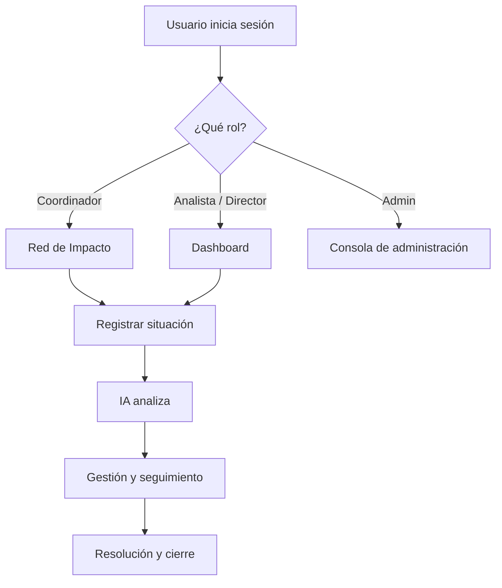

# 01 — Introducción

[← Volver al índice](./README.md)

---

## El problema que resuelve NOVEX

En una institución educativa con múltiples coordinaciones — académica, tecnología, registro, bienestar, finanzas — las situaciones operacionales surgen a diario: caídas de plataforma, inconsistencias académicas, degradación de servicios.

Hoy, esa información suele dispersarse en correos, chats y reportes informales. Los directivos no tienen una vista consolidada del impacto. Los coordinadores no ven cómo un incidente en su área afecta a otras. Y cuando llega el momento de decidir, falta contexto estructurado.

**NOVEX resuelve esto** centralizando el ciclo completo: registro → análisis → seguimiento → cierre.

## Por qué existe

NOVEX nació como **Centro de Monitoreo Operativo** para la operación institucional. Su propósito es dar a cada rol las herramientas que necesita:

- **Coordinadores** registran y gestionan situaciones de su área.
- **Analistas** registran situaciones transversales y ejecutan análisis.
- **Directores** supervisan el panorama ejecutivo sin operar el día a día.
- **Administradores** configuran usuarios, roles y el sistema.

## Qué beneficios aporta

| Beneficio                  | Cómo lo logra NOVEX                                                      |
| -------------------------- | ------------------------------------------------------------------------ |
| **Visibilidad**            | Dashboard ejecutivo con KPIs, narrativa IA y mapa de impacto             |
| **Velocidad**              | Análisis automático con Gemini en segundos                               |
| **Trazabilidad**           | Línea de tiempo, evidencias y versiones de análisis                      |
| **Contexto institucional** | Red de Impacto muestra cómo se propaga un incidente entre coordinaciones |
| **Control de acceso**      | Cada rol ve y hace solo lo que le corresponde                            |

## Cómo se usa (visión general)

1. El usuario entra con su cuenta de Google (o email en desarrollo local).
2. Según su rol, aterriza en la vista principal: Red de Impacto, Dashboard o Admin.
3. Registra una situación con título, descripción, coordinación y evidencias.
4. El sistema solicita un análisis de IA que genera un reporte ejecutivo.
5. El equipo da seguimiento en Gestión de Situaciones, actualizando estados.
6. La situación se resuelve y cierra con comentarios obligatorios.

## Qué diferencia a NOVEX de otros sistemas

| Aspecto     | Sistemas tradicionales               | NOVEX                                                     |
| ----------- | ------------------------------------ | --------------------------------------------------------- |
| Enfoque     | Tickets genéricos o hojas de cálculo | Situaciones operacionales institucionales                 |
| Análisis    | Manual o inexistente                 | IA genera reporte ejecutivo estructurado                  |
| Impacto     | Aislado por área                     | Red de Impacto con grafo de coordinaciones                |
| Roles       | Admin / usuario                      | Cuatro roles con permisos granulares y UI adaptada        |
| Seguimiento | Estado binario (abierto/cerrado)     | Ciclo de vida: Abierta → En atención → Resuelta → Cerrada |

## Conceptos clave

Antes de profundizar, conviene conocer estos términos:

| Término            | Significado                                                         |
| ------------------ | ------------------------------------------------------------------- |
| **Situación**      | Un evento operacional registrado (incidente, falla, inconsistencia) |
| **Coordinación**   | Unidad organizacional (ej. Tecnología, Académica, B2B)              |
| **Red de Impacto** | Mapa visual de coordinaciones y cómo se afectan entre sí            |
| **Análisis IA**    | Reporte ejecutivo generado por Gemini sobre una situación           |
| **Gestión**        | Módulo de seguimiento con expediente, estados y recomendaciones     |
| **Dashboard**      | Vista ejecutiva con KPIs, prioridades y actividad reciente          |

## Alcance actual

NOVEX es un producto en producción con las siguientes capacidades confirmadas en el código:

- Autenticación Google OAuth + JWT
- CRUD de situaciones con evidencias y timeline
- Análisis IA con versionado y comparación
- Red de Impacto interactiva
- Dashboard ejecutivo por rol
- Gestión de ciclo de vida de situaciones
- Consola de administración (usuarios, roles, coordinaciones)
- Onboarding guiado por rol
- Despliegue en Google Cloud Run

> Existe un dominio **legado** de eventos operacionales (`operational-events`) del Sprint 6–7 que coexiste con el dominio actual de situaciones. Se documenta en [04-arquitectura-backend](./04-arquitectura-backend.md) como referencia histórica.

## Siguiente paso

Continúa con [02 — Arquitectura general](./02-arquitectura-general.md) para entender cómo se conectan las piezas del sistema.