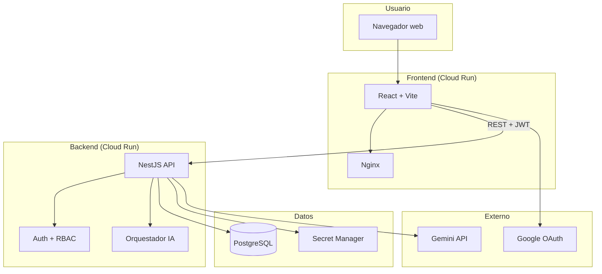
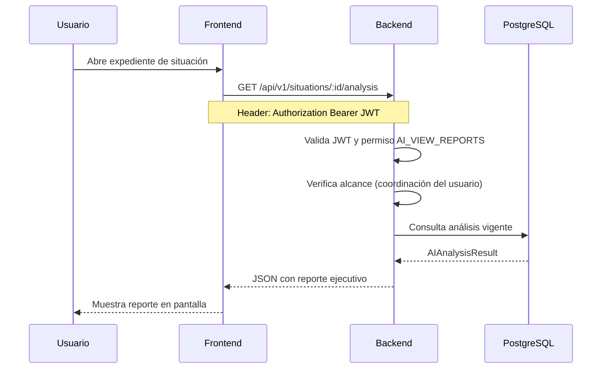
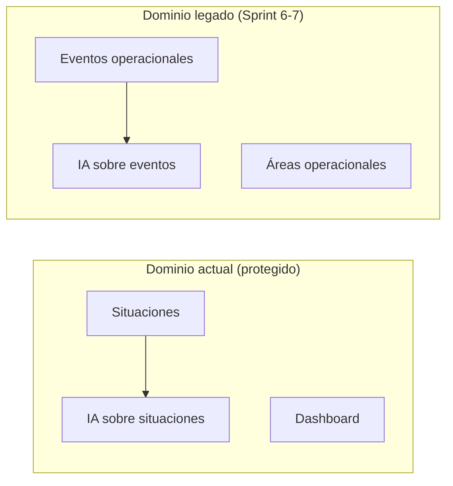

# 02 — Arquitectura General

[← Volver al índice](./README.md)

---

## Vista de alto nivel

NOVEX sigue una arquitectura de tres capas desplegada en Google Cloud Platform:

## Las cinco capas explicadas

### 1. Frontend

La interfaz que ve el usuario. Es una Single Page Application (SPA) en React que se comunica con el backend mediante API REST. Se autentica con Google OAuth y almacena un token JWT en el navegador.

- **Puerto local:** 5173
- **Producción:** Cloud Run (`novex-frontend`)
- **Detalle:** [03-arquitectura-frontend](./03-arquitectura-frontend.md)

### 2. Backend

La API que procesa toda la lógica de negocio: autenticación, permisos, situaciones, análisis IA, reportes y administración.

- **Puerto local:** 3001
- **Prefijo API:** `/api/v1`
- **Producción:** Cloud Run (`novex-backend`)
- **Detalle:** [04-arquitectura-backend](./04-arquitectura-backend.md)

### 3. Inteligencia Artificial

No es un servicio separado: vive dentro del backend. Cuando se solicita un análisis, el orquestador construye un prompt con todo el contexto de la situación, lo envía a Gemini y persiste el resultado estructurado.

- **Modelo:** `gemini-3-flash-preview` (configurable)
- **Detalle:** [08-inteligencia-artificial](./08-inteligencia-artificial.md)

### 4. Base de datos

PostgreSQL almacena usuarios, roles, coordinaciones, situaciones, análisis, evidencias y toda la trazabilidad.

- **Local:** Docker Compose (PostgreSQL 17)
- **Producción:** Cloud SQL (`novex-db`)
- **Detalle:** [05-base-de-datos](./05-base-de-datos.md)

### 5. Cloud (infraestructura)

Google Cloud Platform hospeda todo en producción:

| Servicio | Función |
|----------|---------|
| **Cloud Run** | Ejecuta contenedores del frontend y backend |
| **Cloud SQL** | Base de datos PostgreSQL gestionada |
| **Secret Manager** | Almacena contraseñas, JWT secret y API key de Gemini |
| **Artifact Registry** | Repositorio de imágenes Docker |
| **GitHub Actions** | CI/CD automático al hacer push a `main` |

- **Detalle:** [09-despliegue](./09-despliegue.md)

## Flujo de una petición típica

Ejemplo: un coordinador consulta el análisis IA de una situación.

## Comunicación entre capas

| De → A | Protocolo | Autenticación |
|--------|-----------|---------------|
| Frontend → Backend | HTTPS REST (JSON) | JWT Bearer en header |
| Backend → PostgreSQL | TCP / Unix socket | Usuario + contraseña |
| Backend → Gemini | HTTPS (API REST) | API Key (Secret Manager) |
| Frontend → Google | OAuth 2.0 | ID Token de Google |

## Dominios del backend

El backend tiene dos dominios que coexisten:

| Dominio | Estado | Autenticación |
|---------|--------|---------------|
| **Situaciones** | Activo, dominio principal | JWT + permisos |
| **Eventos operacionales** | Legado, mantenido | Sin autenticación actualmente |

Toda la experiencia de usuario actual (registro, análisis, gestión, Red de Impacto) usa el dominio de **situaciones**.

## Health checks

El backend expone endpoints de salud **antes** de que NestJS termine de arrancar, para que Cloud Run no mate el contenedor durante el cold start:

| Endpoint | Tipo | Qué verifica |
|----------|------|--------------|
| `GET /health` | Liveness | El proceso HTTP responde |
| `GET /health/ready` | Readiness | NestJS + conexión a PostgreSQL |

El frontend expone `GET /health` vía Nginx (respuesta estática `ok`).

## Entornos

| Entorno | Frontend | Backend | Base de datos |
|---------|----------|---------|---------------|
| **Local** | `localhost:5173` | `localhost:3001` | Docker Compose (PostgreSQL local) |
| **Cloud dev** | — | `localhost:3001` + proxy | Cloud SQL vía proxy |
| **Producción** | Cloud Run | Cloud Run | Cloud SQL (`novex-db`) |

## Siguiente paso

Profundiza en la capa que te interese:

- [03 — Arquitectura frontend](./03-arquitectura-frontend.md)
- [04 — Arquitectura backend](./04-arquitectura-backend.md)
