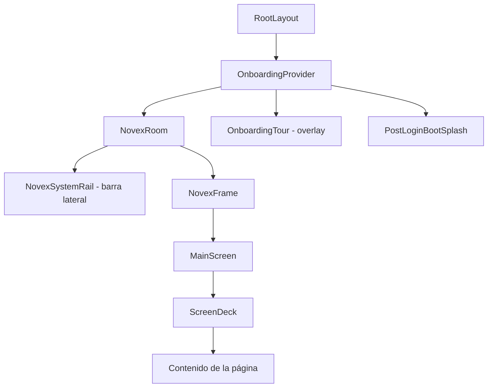
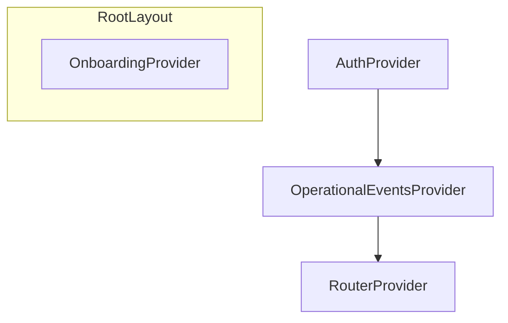
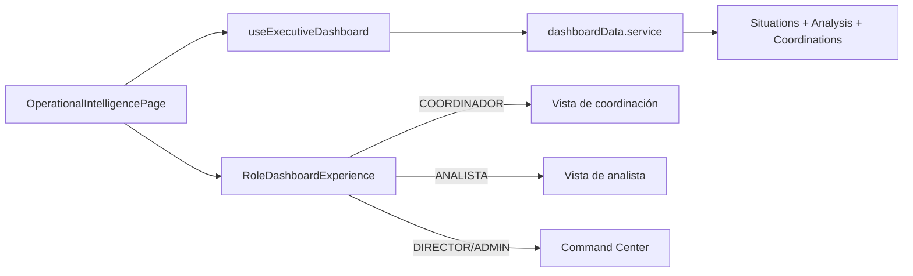
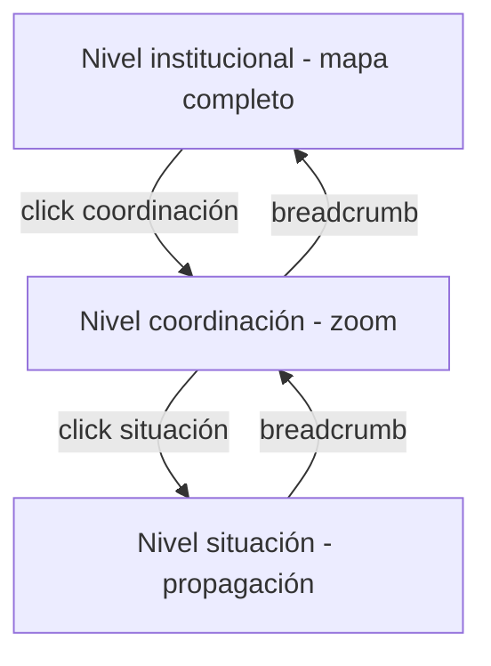
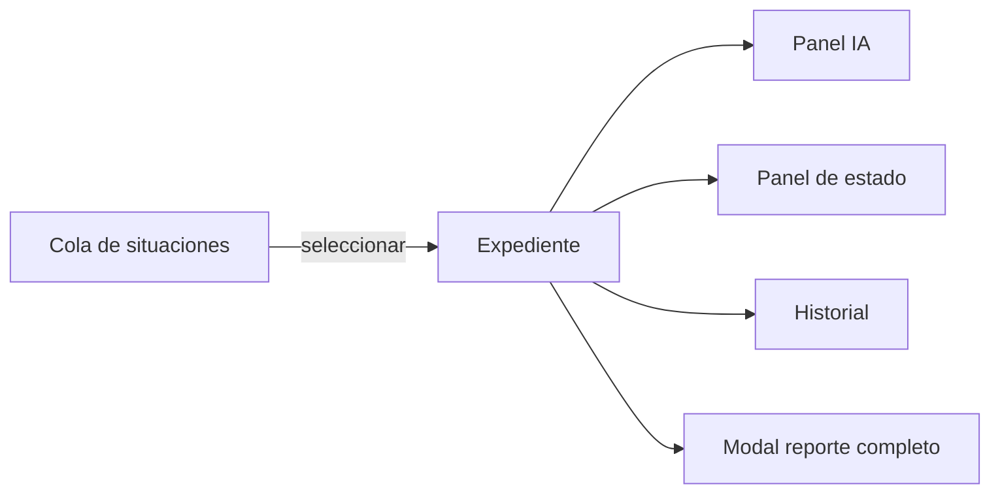

# 03 — Arquitectura Frontend

[← Volver al índice](./README.md)

---

## Stack tecnológico

| Tecnología | Versión | Uso |
|-----------|---------|-----|
| React | 19 | Framework UI |
| TypeScript | — | Tipado estático |
| Vite | 8 | Bundler y dev server |
| Tailwind CSS | v4 | Estilos |
| React Router | v7 | Enrutamiento |
| Motion | — | Animaciones |
| @xyflow/react | — | Grafo de Red de Impacto |
| jsPDF | — | Exportación de reportes a PDF |
| Vitest + Playwright | — | Tests unitarios y E2E |

## Organización de carpetas

```
NOVEX_FRONTEND/src/
├── app/                  # Composición: App, router, providers
├── pages/                # Páginas de ruta (8 páginas)
├── modules/              # Módulos de dominio
│   ├── auth/             # Sesión, JWT, permisos
│   ├── api/              # Clientes HTTP tipados
│   ├── operational-events/  # Registro, wizard, dashboard, análisis
│   ├── monitoring/       # Gestión de situaciones
│   ├── impact-network/   # Red de Impacto
│   ├── situations/       # Tipos y servicios de coordinación
│   ├── onboarding/       # Tour guiado
│   ├── room/             # Shell visual (NovexRoom)
│   └── services/         # Orquestación de datos
├── shared/               # Componentes y utilidades transversales
└── styles/               # CSS por feature
```

**Alias de importación:** `@/` apunta a `src/`.

## Módulos principales

### `auth` — Autenticación y sesión

Gestiona el ciclo de vida de la sesión del usuario.

| Componente | Responsabilidad |
|-----------|-----------------|
| `AuthContext` | Estado global: usuario, token, loading, error |
| `AuthProvider` | Login Google/email, logout, bootstrap de sesión |
| Guards | `ProtectedRoute`, `RequirePermissionRoute`, `RequireRoleRoute` |

Al iniciar sesión, el backend devuelve un JWT con el rol y los permisos embebidos. El frontend los decodifica y los usa para mostrar u ocultar funcionalidades.

### `operational-events` — Situaciones (registro y dashboard)

A pesar del nombre, este módulo maneja las **situaciones** en la UI.

| Submódulo | Qué hace |
|-----------|----------|
| Wizard de captura | Formulario en 3 pasos: captura → revisión → análisis IA |
| Dashboard ejecutivo | KPIs, narrativa, prioridades, tendencias |
| Registro de situaciones | Tabla filtrable con paginación |
| Análisis IA | Panel de reporte ejecutivo con scroll y PDF |

### `monitoring` — Gestión de situaciones

El módulo de seguimiento operativo.

| Componente | Qué hace |
|-----------|----------|
| `MonitoringCenter` | Layout principal de gestión |
| `SituationQueueConsole` | Cola de situaciones ordenada por prioridad |
| `SituationDossierPanel` | Expediente con metadatos |
| `SituationIntelligencePanel` | Resumen IA + enlace al reporte completo |
| `OperationalStatusPanel` | Transiciones de estado del ciclo de vida |
| `OperationalHistoryTimeline` | Línea de tiempo de auditoría |

### `impact-network` — Red de Impacto

Mapa interactivo de coordinaciones institucionales.

| Componente | Qué hace |
|-----------|----------|
| `ImpactNetworkExperience` | Orquestador principal de la experiencia |
| `OrganizationalScene` | Mapa de islas con grafo de dependencias |
| `OperationalContextPanel` | Panel lateral con incidentes y detalle |
| `ImpactNetworkToolbar` | Navegación por niveles (institucional → coordinación → situación) |

### `onboarding` — Tour guiado

Tutorial interactivo que se adapta al rol del usuario.

| Componente | Qué hace |
|-----------|----------|
| `OnboardingProvider` | Estado del tour (paso activo, pasos por rol) |
| `OnboardingTour` | Overlay con spotlight sobre elementos `data-tour` |
| `onboardingTourSteps` | Definición de pasos por rol |

## Layouts y navegación

### Jerarquía visual

Toda vista autenticada se renderiza dentro de un shell visual llamado **NovexRoom**:



`NovexRoom` establece el ambiente visual (`data-scene`, `data-environment-status`) que cambia según el módulo activo y la salud operacional.

### Rutas principales

| Ruta | Página | Permiso / Rol |
|------|--------|---------------|
| `/login` | LoginPage | Público |
| `/` | RoleLandingRoute | Redirige según rol |
| `/dashboard` | OperationalIntelligencePage | `SITUATIONS_VIEW` |
| `/red-impacto` | ImpactNetworkPage | `COORDINATIONS_VIEW` |
| `/situaciones` | OperationalEventsCenterPage | `SITUATIONS_VIEW` |
| `/situaciones/nueva` | RegisterOperationalEventPage | `SITUATIONS_CREATE` + COORDINADOR/ANALISTA |
| `/gestion` | MonitoringPage | `SITUATIONS_VIEW` |
| `/admin` | AdminConsolePage | Rol `ADMIN` |

Existen redirecciones de rutas legadas (`/monitoring` → `/gestion`, `/intelligence` → `/dashboard`, etc.).

### Barra lateral (`NovexSystemRail`)

La navegación cambia según el rol:

| Rol | Elementos visibles |
|-----|-------------------|
| COORDINADOR, ANALISTA | Situaciones, Dashboard, Red de impacto, **Gestión** |
| DIRECTOR | Situaciones, Dashboard, Red de impacto (sin Gestión) |
| ADMIN | Admin + elementos de director (sin Gestión) |

El botón **Registrar situación** solo aparece para COORDINADOR y ANALISTA.

## Contextos y estado global



| Contexto | Qué persiste | Dónde |
|----------|-------------|-------|
| `AuthContext` | Usuario, token, splash | `sessionStorage` + memoria |
| `OperationalEventsContext` | Lista de situaciones | Memoria (se recarga al navegar) |
| `OnboardingContext` | Paso del tour | `localStorage` + backend |

El resto del estado es **local por página** (hooks como `useSituationManagement`, `useExecutiveDashboard`).

## Flujos por módulo

### Dashboard (`/dashboard`)



Cada rol ve un dashboard diferente con los mismos datos subyacentes pero distinta presentación y énfasis.

### Registro de situación (`/situaciones/nueva`)

Tres pasos secuenciales:

1. **Captura** — formulario con título, descripción, coordinación, fecha, método de detección, partes afectadas y evidencias.
2. **Revisión** — resumen antes de confirmar.
3. **Análisis** — el backend ejecuta IA y el frontend hace polling hasta obtener el resultado.

El borrador se guarda en `localStorage` para no perder progreso.

### Red de Impacto (`/red-impacto`)

Tres niveles de navegación:



Funcionalidades adicionales: animación de propagación, simulación de impacto (horizonte 30 min), modo inmersivo (pantalla completa).

### Gestión (`/gestion`)



La URL sincroniza la situación seleccionada: `/gestion?situation={uuid}`.

## Onboarding

El tour se activa automáticamente 500 ms después del login si el usuario no lo ha completado.

| Rol | Pasos | Flujo |
|-----|-------|-------|
| ADMIN | 2 | Consola admin + vista previa de roles |
| DIRECTOR | 5 | Bienvenida + flujo ejecutivo en dashboard |
| ANALISTA | 9 | Bienvenida + flujo ejecutivo + flujo operacional completo |
| COORDINADOR | 8 | Bienvenida (desde Red de Impacto) + flujo operacional completo |

El tour usa atributos `data-tour` en el DOM como contrato de integración. Avanza automáticamente cuando el usuario completa acciones (MutationObserver / IntersectionObserver).

## Capa de API

Los clientes HTTP viven en `modules/api/`:

| Cliente | Endpoints que consume |
|---------|----------------------|
| `auth.api` | `/auth/google`, `/auth/me` |
| `situations.api` | CRUD de situaciones |
| `analysis.api` | Análisis IA, historial, comparación |
| `evidences.api` | Evidencias adjuntas |
| `coordinations.api` | Catálogo y grafo |
| `impact.api` | Evaluación de impacto |
| `admin.api` | Consola de administración |

El cliente HTTP base (`shared/api/http.ts`) inyecta el Bearer token y maneja 401 con logout automático.

## Ambiente visual reactivo

El estado del "ambiente" (salud operacional) se refleja visualmente en toda la interfaz:

| Estado | Significado | Efecto visual |
|--------|-------------|---------------|
| `healthy` | Sin incidentes críticos | Ambiente estable |
| `attention` | Situaciones pendientes o riesgo moderado | Tono de alerta suave |
| `critical` | Situaciones críticas activas | Tono de urgencia |
| `pending` | Sin datos o cargando | Estado neutro |

Se deriva de los datos del dashboard, la gestión o la Red de Impacto según la vista activa.

## Siguiente paso

- [04 — Arquitectura backend](./04-arquitectura-backend.md)
- [06 — Flujo operativo](./06-flujo-operativo.md) para ver cómo se conectan los módulos en la práctica
