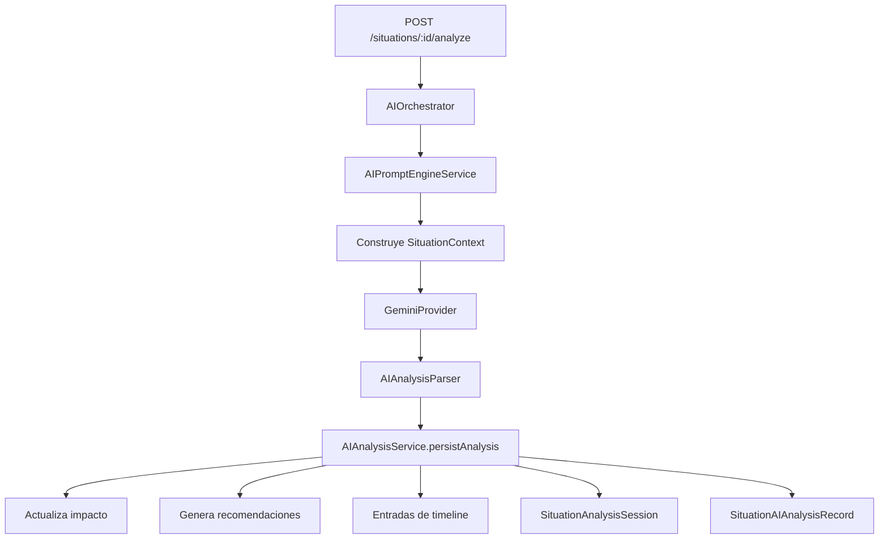
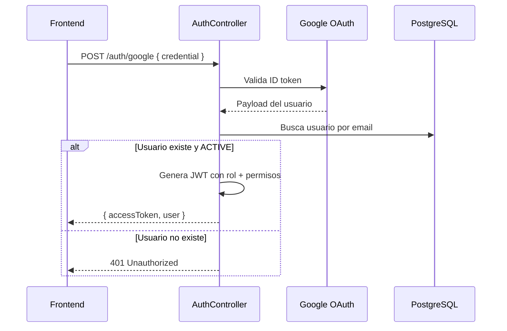

# 04 — Arquitectura Backend

[← Volver al índice](./README.md)

---

## Stack tecnológico

| Tecnología | Versión | Uso |
|-----------|---------|-----|
| NestJS | 11 | Framework API |
| TypeORM | — | ORM para PostgreSQL |
| Passport + JWT | — | Autenticación |
| class-validator | — | Validación de DTOs |
| @google/genai | — | Cliente Gemini (situaciones) |
| @google/generative-ai | — | Cliente Gemini (eventos legado) |

## Organización de módulos

```
NOVEX_BACKEND/src/
├── configuration/          # Env, validación, config TypeORM
├── common/                 # BaseEntity, enums, utilidades
├── database/               # Migraciones y seeds
├── health/                 # Probes /health y /health/ready
├── auth/                   # Login, JWT, guards, alcance operacional
├── rbac/                   # Resolución rol → permisos
├── users/                  # Gestión de usuarios
├── roles/                  # Catálogo de roles
├── permissions/            # Catálogo de permisos
├── coordinations/          # Coordinaciones + grafo de dependencias
├── situations/             # ★ Dominio principal
├── situation-timeline/     # Línea de tiempo
├── situation-evidence/     # Evidencias adjuntas
├── situation-impact/       # Evaluación de impacto
├── situation-recommendations/  # Recomendaciones
├── ai-prompt-engine/       # Construcción de prompts
├── ai-analysis/            # Parser y validador de resultados IA
├── ai-orchestration/       # Orquestador IA (GeminiProvider)
├── ai-analysis-sessions/   # Versionado histórico de análisis
├── dashboard/              # Métricas ejecutivas
├── operational-areas/      # Áreas operacionales (legado)
├── operational-events/     # Eventos operacionales (legado)
├── intelligence/           # IA sobre eventos (legado)
├── recommended-actions/    # Acciones del reporte ejecutivo (legado)
└── demo-users/             # Onboarding demo (legado, sin auth)
```

## Punto de entrada

`main.ts` sigue una secuencia optimizada para Cloud Run:

1. Abre un listener HTTP inmediato (responde `/health` antes de NestJS).
2. Verifica conexión a PostgreSQL.
3. Carga `AppModule` con prefijo global `api/v1`.
4. Aplica `ValidationPipe` estricto y CORS abierto.

## Módulos del dominio principal

### `situations` — Situaciones operacionales

El corazón del sistema. Gestiona el ciclo de vida completo.

| Componente | Responsabilidad |
|-----------|-----------------|
| `SituationsController` | Endpoints CRUD |
| `SituationsService` | Lógica de negocio y transiciones de estado |
| `SituationAccessService` | Control de acceso por coordinación |

**Estados del ciclo de vida:**

```
OPEN → IN_PROGRESS → RESOLVED → CLOSED
```

- `OPEN → IN_PROGRESS`: asigna responsable automáticamente.
- Hacia `RESOLVED` o `CLOSED`: requiere comentario obligatorio.
- Una situación `CLOSED` no admite más cambios.

### `situation-timeline` — Trazabilidad

Registra cada evento significativo: creación, cambio de estado, análisis IA iniciado/completado/fallido, reanálisis.

### `situation-evidence` — Evidencias

Archivos adjuntos a una situación (capturas, documentos). Actualmente almacena rutas locales; el código indica delegación futura a Cloud Storage.

### `situation-impact` — Evaluación de impacto

Almacena la evaluación de impacto de una situación y las coordinaciones afectadas. Se actualiza automáticamente cuando la IA genera un análisis.

### `situation-recommendations` — Recomendaciones

Recomendaciones accionables generadas por IA o creadas manualmente. Cada una tiene título, descripción y prioridad.

## Capa de inteligencia artificial



| Módulo | Función |
|--------|---------|
| `ai-prompt-engine` | Construye el prompt con contexto completo de la situación |
| `ai-analysis` | Define el contrato `AIAnalysisResult`, parser y validador |
| `ai-orchestration` | Orquesta la llamada a Gemini y persiste el resultado |
| `ai-analysis-sessions` | Versionado: historial, versión específica, comparación |

Detalle completo en [08-inteligencia-artificial](./08-inteligencia-artificial.md).

## Autenticación

### Flujo de login



**Importante:** NOVEX no auto-registra usuarios. Un administrador debe crear la cuenta previamente.

### JWT

El token incluye: `sub`, `email`, `roleId`, `roleCode`, `coordinationId`, `permissions[]`, `status`.

Los guards validan permisos **desde el token**, sin consultar la base de datos en cada request.

### Guards y decoradores

| Guard / Decorador | Función |
|-------------------|---------|
| `JwtAuthGuard` | Valida Bearer token |
| `PermissionsGuard` | Lee `@RequirePermissions('CODE')` |
| `@CurrentUser()` | Inyecta el `AuthPayload` del token |

### Alcance operacional

`OperationalScopeService` restringe el acceso según el rol:

| Rol | Alcance |
|-----|---------|
| COORDINADOR | Solo situaciones de su `coordinationId` |
| ANALISTA | Puede crear situaciones sin coordinación asignada |
| DIRECTOR | Lectura amplia, sin crear situaciones |
| ADMIN | Gestión de usuarios y configuración |

## Permisos (RBAC)

17 permisos organizados en 7 módulos. La asignación por rol está definida en `permissions.catalog.seed.ts`:

| Módulo | Permisos |
|--------|----------|
| AUTH | `AUTH_LOGIN`, `AUTH_VIEW_PROFILE` |
| USERS | `USERS_VIEW`, `USERS_CREATE`, `USERS_UPDATE`, `USERS_DELETE` |
| COORDINATIONS | `COORDINATIONS_VIEW`, `COORDINATIONS_MANAGE` |
| SITUATIONS | `SITUATIONS_VIEW`, `SITUATIONS_CREATE`, `SITUATIONS_UPDATE`, `SITUATIONS_CLOSE` |
| AI | `AI_ANALYZE`, `AI_VIEW_REPORTS` |
| REPORTS | `REPORTS_VIEW`, `REPORTS_EXPORT` |
| SYSTEM | `SYSTEM_CONFIGURATION` |

Detalle por rol en [07-roles](./07-roles.md).

## Dashboard y reportes

No existe un módulo `reports/` independiente. Los reportes se distribuyen:

| Componente | Endpoint | Permiso |
|-----------|----------|---------|
| `DashboardModule` | `GET /dashboard/metrics` | `REPORTS_VIEW` |
| `AIOrchestrationModule` | `GET /situations/:id/analysis` | `AI_VIEW_REPORTS` |
| `AIAnalysisSessionsModule` | Historial y comparación | `AI_VIEW_REPORTS` |

> **Nota:** el dashboard del frontend **no consume** `GET /dashboard/metrics`. Construye los KPIs en el cliente agregando datos de situaciones, análisis, coordinaciones y timeline (`dashboardData.service.ts`). El endpoint de backend existe como contrato institucional y está orientado al dominio legado de eventos operacionales.

## Onboarding

| Endpoint | Función |
|----------|---------|
| `PATCH /users/me/onboarding` | Actualiza progreso del tour |

Campos en la entidad `User`: `onboardingStep`, `onboardingCompleted`, `onboardingSeenAt`.

## Coordinaciones

Catálogo de coordinaciones institucionales con grafo de dependencias.

| Endpoint | Función |
|----------|---------|
| `GET /coordinations` | Lista de coordinaciones activas |
| `GET /coordinations/graph` | Grafo de dependencias |
| `GET /coordinations/network-status` | Estado de la red (estable/atención/crítico) |
| `GET /coordinations/:id` | Detalle de una coordinación |

Las dependencias tienen tipos: `TECHNICAL`, `COMMUNICATION`, `OPERATIONAL`, `ACADEMIC`.

## Dominio legado (Sprint 6–7)

Estos módulos coexisten con el dominio de situaciones pero **no forman parte de la experiencia principal actual**:

| Módulo | Estado | Autenticación |
|--------|--------|---------------|
| `operational-areas` | Legado | Sin auth |
| `operational-events` | Legado | Sin auth |
| `intelligence` | Legado (IA sobre eventos) | Sin auth |
| `recommended-actions` | Legado | Sin auth |
| `demo-users` | Legado (onboarding demo) | Sin auth |

> **Nota de seguridad:** los endpoints legados están expuestos sin JWT. El dominio de situaciones sí está protegido.

## Seeds y catálogos

Al arrancar en desarrollo (`CATALOG_SEED_ON_BOOT=true`), el backend siembra:

- Roles y permisos
- Coordinaciones y dependencias
- Categorías de incidentes
- Áreas operacionales (legado)
- Usuario admin bootstrap (si hay rol y coordinación disponibles)

En producción, `CATALOG_SEED_ON_BOOT=false`.

## Migraciones

El esquema se gestiona exclusivamente con migraciones TypeORM (`DB_SYNCHRONIZE=false` siempre):

1. `InitialSchema` — esquema completo
2. `MakeUserCoordinationNullable` — coordinación opcional en usuarios
3. `AddUserOnboardingState` — campos de onboarding
4. `AllowAnalystUnassignedSituations` — analistas sin coordinación fija

## API — Resumen de endpoints

**Base:** `http://localhost:3001/api/v1`

### Protegidos (JWT + permisos)

| Grupo | Endpoints principales |
|-------|----------------------|
| Auth | `POST /auth/google`, `GET /auth/me` |
| Usuarios | CRUD + `PATCH /users/me/onboarding` |
| Situaciones | CRUD + timeline + evidencias + impacto + recomendaciones |
| IA | `POST /situations/:id/analyze`, `GET .../analysis`, historial, comparación |
| Coordinaciones | Lista, grafo, network-status, detalle |
| Dashboard | `GET /dashboard/metrics` |
| Admin | Roles, permisos (requiere `SYSTEM_CONFIGURATION`) |

### Sin autenticación

| Grupo | Nota |
|-------|------|
| Health | `/health`, `/health/ready` |
| Legado | operational-areas, operational-events, intelligence, demo-users |

## Siguiente paso

- [05 — Base de datos](./05-base-de-datos.md)
- [08 — Inteligencia artificial](./08-inteligencia-artificial.md)
