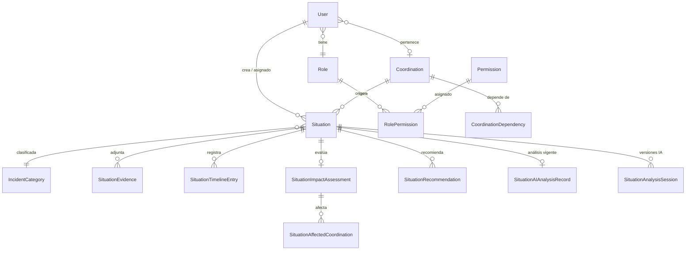
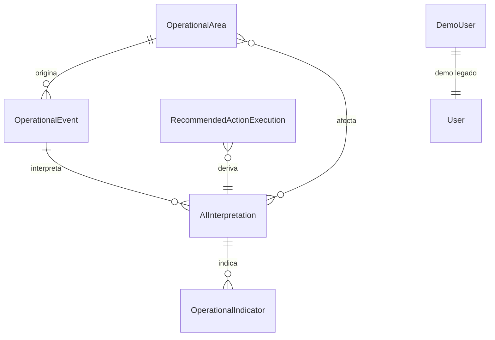

# 05 — Base de Datos

[← Volver al índice](./README.md)

---

## Motor y configuración

| Parámetro | Valor |
|-----------|-------|
| Motor | PostgreSQL 17 |
| ORM | TypeORM |
| Local | Docker Compose (`docker-compose.yml`) |
| Producción | Cloud SQL (`it-fab-contenido-edu-5:us-central1:novex-db`) |
| Sincronización automática | Desactivada (`DB_SYNCHRONIZE=false`) |
| Esquema | Solo vía migraciones TypeORM |

## Dominio principal: Situaciones

Este es el modelo de datos que impulsa toda la experiencia actual de NOVEX.



## Entidades principales

### Identidad y acceso

| Entidad | Tabla | Qué representa |
|---------|-------|----------------|
| **User** | `users` | Persona con acceso al sistema. Tiene rol, coordinación (opcional) y estado de onboarding. |
| **Role** | `roles` | Perfil institucional: ADMIN, DIRECTOR, ANALISTA, COORDINADOR. |
| **Permission** | `permissions` | Acción granular (17 permisos en 7 módulos). |
| **RolePermission** | `role_permissions` | Relación muchos-a-muchos entre roles y permisos. |

**User** almacena: email, nombre, estado (`ACTIVE`/`INACTIVE`), rol, coordinación asignada, y campos de onboarding (`onboardingStep`, `onboardingCompleted`, `onboardingSeenAt`).

### Organización institucional

| Entidad | Tabla | Qué representa |
|---------|-------|----------------|
| **Coordination** | `coordinations` | Unidad organizacional (ej. Tecnología, Académica, B2B). Tiene código, nombre, color, icono y orden de visualización. |
| **CoordinationDependency** | `coordination_dependencies` | Relación de dependencia entre dos coordinaciones, con tipo (técnica, académica, operacional, comunicación) y peso. |

El grafo de dependencias alimenta la Red de Impacto y la evaluación de propagación de la IA.

### Situaciones (núcleo operacional)

| Entidad | Tabla | Qué representa |
|---------|-------|----------------|
| **Situation** | `situations` | Un evento operacional registrado. Tiene título, descripción, coordinación de origen, categoría, severidad, estado y fechas. |
| **IncidentCategory** | `incident_categories` | Taxonomía de tipos de incidente (caída de plataforma, inconsistencia académica, etc.). |
| **SituationEvidence** | `situation_evidences` | Archivo adjunto a una situación (nombre, tipo MIME, ruta de almacenamiento). |
| **SituationTimelineEntry** | `situation_timeline_entries` | Evento de auditoría: quién hizo qué y cuándo. |

**Estados de una situación:**

| Estado | Significado |
|--------|-------------|
| `OPEN` | Recién registrada, sin atención asignada |
| `IN_PROGRESS` | En proceso de atención |
| `RESOLVED` | Mitigada o resuelta (requiere comentario) |
| `CLOSED` | Cerrada definitivamente (requiere comentario, no admite cambios) |

### Impacto y recomendaciones

| Entidad | Tabla | Qué representa |
|---------|-------|----------------|
| **SituationImpactAssessment** | `situation_impact_assessments` | Evaluación de impacto (severidad, confianza, duración estimada, resumen). Relación 1:1 con la situación. |
| **SituationAffectedCoordination** | `situation_affected_coordinations` | Coordinación afectada por la situación, con nivel de impacto. |
| **SituationRecommendation** | `situation_recommendations` | Acción recomendada (título, descripción, prioridad). Puede ser generada por IA o manual. |

### Inteligencia artificial

| Entidad | Tabla | Qué representa |
|---------|-------|----------------|
| **SituationAIAnalysisRecord** | `situation_ai_analysis_records` | Puntero al análisis IA **vigente** de una situación. |
| **SituationAnalysisSession** | `situation_analysis_sessions` | Versión histórica de un análisis. Almacena el `AIAnalysisResult` completo en JSONB. |

Cada vez que se ejecuta un análisis, se crea una nueva sesión y se actualiza el registro vigente. Esto permite comparar versiones.

## Dominio legado: Eventos operacionales

Estas entidades del Sprint 6–7 coexisten pero no alimentan la experiencia principal:



| Entidad | Qué representa |
|---------|----------------|
| **OperationalArea** | Área operacional del catálogo legado (Tecnología, Registro, etc.) |
| **OperationalEvent** | Evento operacional del modelo anterior |
| **AIInterpretation** | Interpretación IA sobre un evento, con `executiveReport` en JSONB |
| **OperationalIndicator** | Indicador derivado de una interpretación |
| **RecommendedActionExecution** | Acción ejecutable del reporte ejecutivo |
| **DemoUser** | Usuario demo del onboarding anterior (ID string, no UUID) |

## Relaciones clave explicadas

### Usuario → Coordinación

Un usuario puede pertenecer a una coordinación (`coordinationId`) o no tener ninguna (analistas). Esto determina su alcance operacional: un coordinador solo ve situaciones de su coordinación.

### Situación → Coordinación

Cada situación tiene una coordinación de origen. Los analistas pueden crear situaciones sin coordinación asignada (`coordinationId = null`).

### Situación → Análisis IA

Relación 1:1 para el análisis vigente (`SituationAIAnalysisRecord`) y 1:N para el historial (`SituationAnalysisSession`). El JSONB almacena el contrato completo `AIAnalysisResult`.

### Coordinación → Coordinación (grafo)

`CoordinationDependency` modela cómo las coordinaciones dependen entre sí. Esto alimenta:
- La Red de Impacto (visualización del mapa)
- La evaluación de propagación de la IA
- El endpoint `GET /coordinations/graph`

## Catálogos sembrados

Al arrancar en desarrollo, se insertan automáticamente:

| Catálogo | Ejemplos |
|----------|----------|
| Roles | ADMIN, DIRECTOR, ANALISTA, COORDINADOR |
| Permisos | 17 permisos en 7 módulos |
| Coordinaciones | General, B2B, Bellas Artes, Ingenierías, etc. |
| Dependencias | ~17 relaciones entre coordinaciones |
| Categorías de incidente | Caída de plataforma, inconsistencia académica, degradación tecnológica |
| Áreas operacionales (legado) | TEC, REG, ACA, FIN, BIEN, DIR |

## Migraciones

| # | Nombre | Qué hace |
|---|--------|----------|
| 1 | `InitialSchema` | Crea todas las tablas del esquema completo |
| 2 | `MakeUserCoordinationNullable` | Permite usuarios sin coordinación asignada |
| 3 | `AddUserOnboardingState` | Agrega campos de progreso del tour |
| 4 | `AllowAnalystUnassignedSituations` | Permite situaciones sin coordinación (analistas) |

**Comandos:**

```bash
npm run migration:run      # Aplicar migraciones pendientes
npm run migration:revert   # Revertir última migración
```

> En producción, las migraciones se ejecutan manualmente. No hay automatización en el pipeline de deploy.

## Índices relevantes

Las tablas más consultadas tienen índices compuestos:

- `situations`: por `(status, occurred_at)` y por `(coordination_id, status)`
- `users`: por `email` (único)
- `permissions`: por `code` (único)
- `coordinations`: por `code` (único)

## Siguiente paso

- [06 — Flujo operativo](./06-flujo-operativo.md) para ver cómo fluyen los datos en la práctica
- [08 — Inteligencia artificial](./08-inteligencia-artificial.md) para el contrato de datos IA
