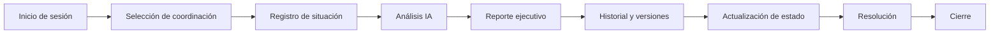
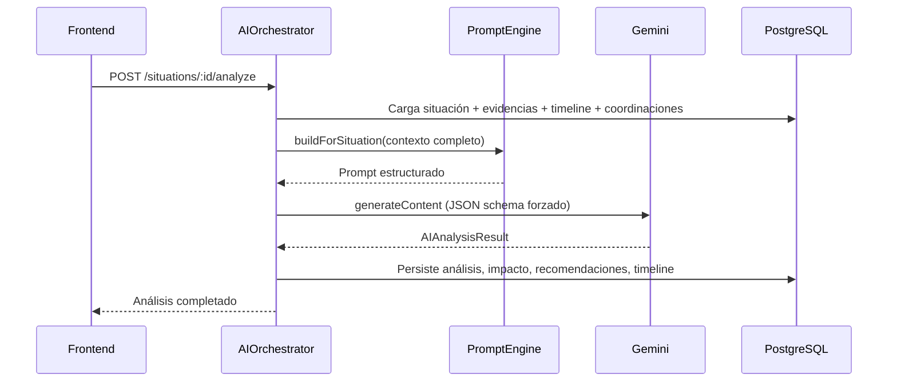
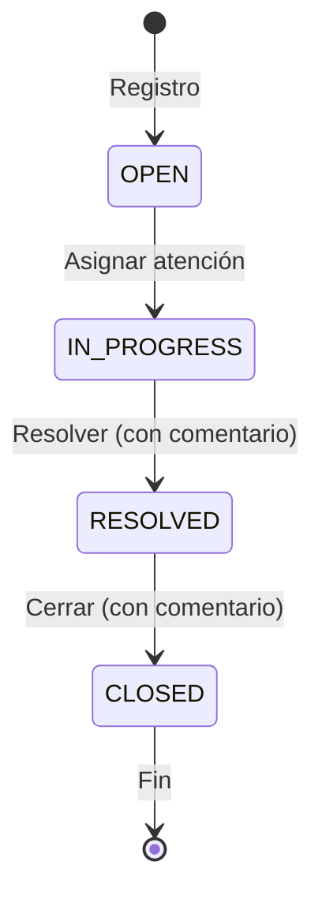
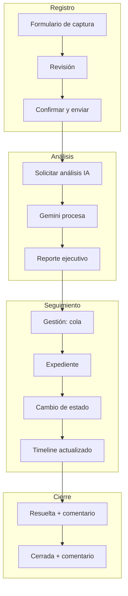

# 06 — Flujo Operativo

[← Volver al índice](./README.md)

---

Este documento narra el ciclo completo de una situación en NOVEX, paso a paso, como una historia que cualquier persona puede seguir.

## Panorama del ciclo



---

## Paso 1: El usuario inicia sesión

María es coordinadora de Tecnología. Abre NOVEX en su navegador y ve la pantalla de login.

**Qué ocurre:**
1. Hace clic en "Iniciar sesión con Google".
2. Google valida su identidad y devuelve un ID token.
3. El frontend envía el token al backend: `POST /api/v1/auth/google`.
4. El backend verifica que María existe en la base de datos y está activa.
5. Genera un JWT con su rol (`COORDINADOR`), coordinación y permisos.
6. El frontend almacena el token y muestra el splash de bienvenida.

**Si es su primer acceso**, el tour de onboarding se activa automáticamente después del splash.

> En desarrollo local, también existe login por email (`ENABLE_EMAIL_LOGIN=true`).

---

## Paso 2: Selección de coordinación

Según su rol, María aterriza en una vista diferente:

| Rol | Vista de aterrizaje |
|-----|-------------------|
| COORDINADOR | Red de Impacto (con su coordinación preseleccionada) |
| ANALISTA / DIRECTOR | Dashboard ejecutivo |
| ADMIN | Consola de administración |

María ve la **Red de Impacto** con su coordinación (Tecnología) ya enfocada. Puede explorar el mapa institucional, ver situaciones activas en su área y las de otras coordinaciones (solo lectura).

**Un analista**, en cambio, aterrizaría en el Dashboard y tendría que **elegir** la coordinación al registrar una situación.

---

## Paso 3: Registro de una situación

María detecta que el LMS está caído. Va a **Situaciones → Registrar situación** (o usa el botón CTA en la barra lateral).

### Paso 3.1 — Captura

Completa el formulario:

| Campo | Valor de ejemplo |
|-------|-----------------|
| Título | "Caída del LMS en horario pico" |
| Descripción | "Estudiantes no pueden acceder al campus virtual desde las 8:00 AM" |
| Coordinación | Tecnología (bloqueada para coordinadores) |
| Fecha del evento | Hoy, 8:00 AM |
| Método de detección | Reporte de usuario |
| Partes afectadas | Estudiantes, docentes |
| Evidencias | Captura de pantalla del error |

El borrador se guarda automáticamente en el navegador por si pierde la conexión.

### Paso 3.2 — Revisión

María revisa un resumen de lo que registró y confirma.

### Paso 3.3 — Envío

El frontend envía `POST /api/v1/situations` con los datos y evidencias. El backend:

1. Crea la situación con estado `OPEN`.
2. Guarda las evidencias adjuntas.
3. Registra una entrada en el timeline: "Situación creada".
4. Devuelve la situación creada.

---

## Paso 4: La IA analiza

Al confirmar el registro, el wizard avanza al paso de **Análisis**. El frontend solicita:

```
POST /api/v1/situations/{id}/analyze
```

**Qué hace el backend internamente:**



El frontend hace polling hasta que el análisis esté listo y muestra el resultado.

---

## Paso 5: Se genera el reporte

El análisis IA produce un **reporte ejecutivo estructurado** con secciones como:

| Sección | Qué contiene |
|---------|-------------|
| Resumen ejecutivo | Titular, resumen y puntos clave |
| Clasificación | Categoría, severidad, etiquetas |
| Causa raíz | Hipótesis con evidencia de soporte |
| Evaluación de impacto | Severidad, coordinaciones afectadas, propagación |
| Recomendaciones | Acciones priorizadas |
| Riesgos inmediatos y futuros | Qué puede empeorar |
| Información faltante | Qué datos adicionales se necesitan |
| Conclusión ejecutiva | Decisión recomendada y siguiente paso |
| Confianza | Nivel de certeza del análisis |

María puede leer el reporte en el wizard o más tarde en Gestión.

---

## Paso 6: Historial y versiones

Cada análisis queda registrado como una **versión** en `SituationAnalysisSession`. Si más tarde se reanaliza la situación (porque se agregaron evidencias o cambió el contexto), se crea una nueva versión.

El equipo puede:
- Ver el historial: `GET /situations/:id/analysis/history`
- Consultar una versión específica
- Comparar dos versiones: `GET /situations/:id/analysis/compare?fromVersion=1&toVersion=2`

---

## Paso 7: Actualización de estado

María va a **Gestión de Situaciones** (`/gestion`). Ve la cola de situaciones y selecciona la suya.

### Transiciones disponibles



| Transición | Quién | Requisito |
|-----------|-------|-----------|
| OPEN → IN_PROGRESS | Coordinador / Analista | Automático al tomar la situación |
| IN_PROGRESS → RESOLVED | Coordinador / Analista | Comentario obligatorio |
| RESOLVED → CLOSED | Coordinador / Analista | Comentario obligatorio |

Cada cambio genera una entrada en el timeline con el usuario, la hora y el comentario.

---

## Paso 8: Resolución

El equipo de Tecnología restaura el LMS. María actualiza el estado a **Resuelta** y escribe:

> "LMS restaurado a las 10:30 AM. Causa: fallo en el balanceador de carga. Se reinició el servicio."

El backend registra la transición y actualiza el timeline.

---

## Paso 9: Cierre

Después de verificar que todo funciona correctamente, María cierra la situación:

> "Verificado acceso de 50 estudiantes de prueba. Sin incidencias posteriores."

La situación pasa a estado **Cerrada** y **no admite más cambios**.

---

## Lo que ven los otros roles durante este flujo

### Director

- Ve la situación en el **Dashboard** (lista de prioridades, KPIs actualizados).
- Puede consultar el reporte IA en modo lectura.
- Ve el impacto en la **Red de Impacto** (coordinaciones afectadas).
- **No puede** registrar situaciones ni cambiar estados.

### Analista

- Puede registrar situaciones de cualquier coordinación (o sin coordinación).
- Tiene acceso completo a Gestión, análisis IA y reportes.
- Su dashboard enfatiza acciones operativas.

### Administrador

- Gestiona usuarios y configuración en `/admin`.
- Puede previsualizar el dashboard de otros roles (`?preview=COORDINADOR`).
- No registra situaciones (no tiene permiso `SITUATIONS_CREATE`).

---

## Flujo visual resumido



---

## Siguiente paso

- [07 — Roles y permisos](./07-roles.md) para entender quién puede hacer cada paso
- [08 — Inteligencia artificial](./08-inteligencia-artificial.md) para profundizar en el análisis IA
