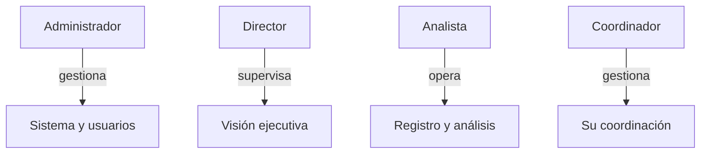
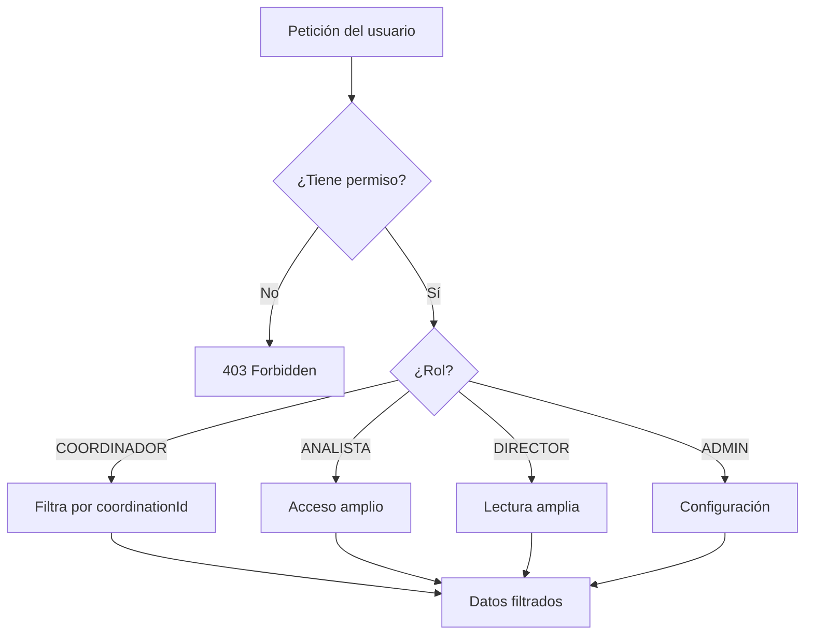

# 07 — Roles y Permisos

[← Volver al índice](./README.md)

---

## Los cuatro roles de NOVEX

NOVEX define cuatro roles institucionales. Cada uno tiene un objetivo claro, permisos específicos y una interfaz adaptada.

---

## Coordinador

> *"Gestión operativa dentro de una coordinación."*

### Objetivo

Registrar, analizar y dar seguimiento a las situaciones de **su coordinación asignada**.

### Qué puede hacer

| Acción | Detalle |
|--------|---------|
| Ver situaciones | Solo de su coordinación |
| Registrar situaciones | Coordinación bloqueada a la suya |
| Ejecutar análisis IA | Sobre situaciones de su coordinación |
| Ver reportes IA | De sus situaciones |
| Actualizar estados | En Gestión de Situaciones |
| Ver Red de Impacto | Con su coordinación preseleccionada |
| Ver Dashboard | Vista de coordinación |

### Qué no puede hacer

- Ver o modificar situaciones de otras coordinaciones
- Crear usuarios ni administrar el sistema
- Exportar reportes institucionales
- Acceder a la consola de administración

### Cómo cambia su interfaz

| Elemento | Comportamiento |
|----------|---------------|
| **Aterrizaje** | Red de Impacto con su coordinación enfocada |
| **Barra lateral** | Situaciones, Dashboard, Red de impacto, Gestión |
| **Registrar situación** | CTA visible; coordinación preseleccionada |
| **Red de Impacto** | No puede abrir coordinaciones ajenas ni incidentes fuera de su área |
| **Dashboard** | Vista "Panel de coordinación" con resumen operativo |
| **Onboarding** | 8 pasos desde Red de Impacto |

---

## Analista

> *"Análisis operacional e interpretación de situaciones."*

### Objetivo

Registrar situaciones transversales (de cualquier coordinación o sin coordinación), ejecutar análisis IA y dar seguimiento operativo.

### Qué puede hacer

| Acción | Detalle |
|--------|---------|
| Ver situaciones | De todas las coordinaciones |
| Registrar situaciones | Debe elegir coordinación (o dejar sin asignar) |
| Ejecutar análisis IA | Sobre cualquier situación visible |
| Ver reportes IA | Todos |
| Actualizar estados | En Gestión |
| Ver Red de Impacto | Acceso completo |
| Ver Dashboard | Vista de analista con barra de acciones |
| Ver reportes institucionales | Dashboard metrics |

### Qué no puede hacer

- Crear usuarios ni administrar roles
- Exportar reportes (`REPORTS_EXPORT`)
- Acceder a la consola de administración

### Cómo cambia su interfaz

| Elemento | Comportamiento |
|----------|---------------|
| **Aterrizaje** | Dashboard ejecutivo |
| **Barra lateral** | Igual que coordinador (incluye Gestión) |
| **Registrar situación** | Debe seleccionar coordinación del catálogo |
| **Dashboard** | Vista "Centro de monitoreo" con últimas situaciones |
| **Onboarding** | 9 pasos (ejecutivo + operacional completo) |

---

## Director

> *"Visión ejecutiva y priorización institucional."*

### Objetivo

Supervisar el panorama operacional completo sin intervenir en el día a día. Tomar decisiones basadas en reportes y KPIs.

### Qué puede hacer

| Acción | Detalle |
|--------|---------|
| Ver situaciones | De todas las coordinaciones (solo lectura) |
| Ver reportes IA | Todos (solo lectura) |
| Ver Dashboard | Command Center ejecutivo |
| Ver Red de Impacto | Acceso completo (solo lectura) |
| Ver reportes institucionales | Con exportación |
| Ver coordinaciones | Catálogo y grafo |

### Qué no puede hacer

- Registrar situaciones
- Ejecutar análisis IA
- Cambiar estados de situaciones
- Acceder a Gestión de Situaciones
- Administrar usuarios o sistema

### Cómo cambia su interfaz

| Elemento | Comportamiento |
|----------|---------------|
| **Aterrizaje** | Dashboard ejecutivo |
| **Barra lateral** | Sin "Gestión de situaciones" |
| **Registrar situación** | CTA **no visible** |
| **Dashboard** | Command Center con KPIs, prioridades, mapa de impacto |
| **Onboarding** | 5 pasos enfocados en visión ejecutiva |

---

## Administrador

> *"Administración completa del sistema NOVEX."*

### Objetivo

Gestionar usuarios, roles, coordinaciones y la configuración del sistema.

### Qué puede hacer

| Acción | Detalle |
|--------|---------|
| Todo lo del Director | Más exportación de reportes |
| Crear y gestionar usuarios | CRUD completo |
| Ver roles y permisos | Catálogo del sistema |
| Configuración del sistema | `SYSTEM_CONFIGURATION` |
| Previsualizar dashboards | `?preview=COORDINADOR\|ANALISTA\|DIRECTOR` |

### Qué no puede hacer

- Registrar situaciones (permiso `SITUATIONS_CREATE` explícitamente excluido)
- Ejecutar análisis IA directamente

### Cómo cambia su interfaz

| Elemento | Comportamiento |
|----------|---------------|
| **Aterrizaje** | Consola de administración (`/admin`) |
| **Barra lateral** | Admin + elementos de director |
| **Admin console** | Usuarios, Roles, Coordinaciones, Permisos, Sistema |
| **Onboarding** | 2 pasos (admin + vista previa de roles) |

---

## Matriz de permisos

| Permiso | ADMIN | DIRECTOR | ANALISTA | COORDINADOR |
|---------|:-----:|:--------:|:--------:|:-----------:|
| AUTH_VIEW_PROFILE | ✓ | ✓ | ✓ | ✓ |
| USERS_VIEW | ✓ | — | — | — |
| USERS_CREATE | ✓ | — | — | — |
| USERS_UPDATE | ✓ | — | — | — |
| USERS_DELETE | ✓ | — | — | — |
| COORDINATIONS_VIEW | ✓ | ✓ | ✓ | ✓ |
| COORDINATIONS_MANAGE | ✓ | — | — | — |
| SITUATIONS_VIEW | ✓ | ✓ | ✓ | ✓ |
| SITUATIONS_CREATE | — | — | ✓ | ✓ |
| SITUATIONS_UPDATE | ✓ | — | ✓ | ✓ |
| SITUATIONS_CLOSE | ✓ | — | — | — |
| AI_ANALYZE | ✓ | — | ✓ | ✓ |
| AI_VIEW_REPORTS | ✓ | ✓ | ✓ | ✓ |
| REPORTS_VIEW | ✓ | ✓ | ✓ | — |
| REPORTS_EXPORT | ✓ | ✓ | — | — |
| SYSTEM_CONFIGURATION | ✓ | — | — | — |

> El permiso `SITUATIONS_CLOSE` existe en el catálogo pero las transiciones de cierre se realizan con `SITUATIONS_UPDATE` en la práctica actual.

## Alcance operacional

Además de los permisos, existe un **filtro por coordinación** que restringe qué datos ve cada usuario:

| Rol | Filtro de datos |
|-----|----------------|
| COORDINADOR | Solo situaciones donde `situation.coordinationId = user.coordinationId` |
| ANALISTA | Sin filtro de coordinación; puede crear situaciones con `coordinationId = null` |
| DIRECTOR | Sin filtro; solo lectura |
| ADMIN | Sin filtro; gestión de configuración |

## Cómo se implementan los permisos

1. Al hacer login, el backend resuelve los permisos del rol y los **embebe en el JWT**.
2. El frontend decodifica el token y usa los permisos para mostrar/ocultar UI.
3. En cada request al backend, `PermissionsGuard` valida el permiso requerido contra el token.
4. `OperationalScopeService` aplica el filtro de coordinación en consultas de situaciones.

Los permisos **no se consultan de la base de datos en cada request** — van en el token. Si un administrador cambia los permisos de un rol, el usuario debe volver a iniciar sesión para obtener el token actualizado.

## Siguiente paso

- [06 — Flujo operativo](./06-flujo-operativo.md) para ver cómo interactúan los roles en la práctica
- [08 — Inteligencia artificial](./08-inteligencia-artificial.md) para entender quién puede ejecutar análisis
