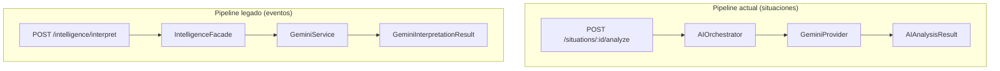
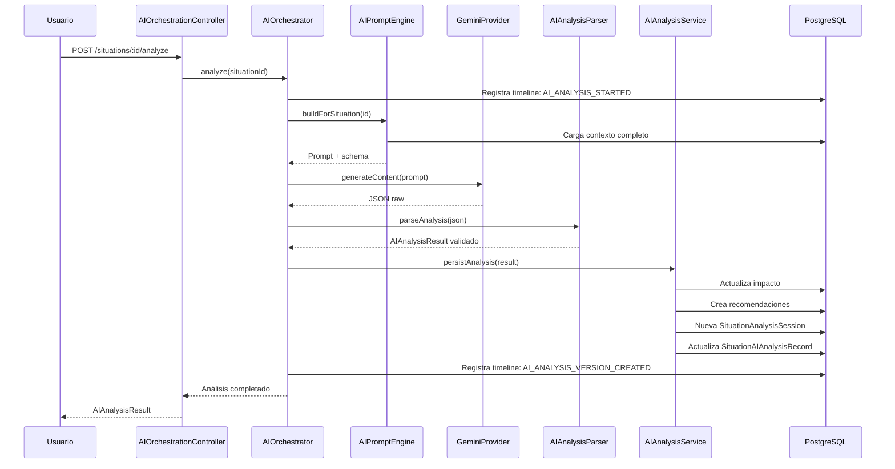

# 08 — Inteligencia Artificial

[← Volver al índice](./README.md)

---

## Papel de la IA en NOVEX

La inteligencia artificial no es un chatbot ni un asistente conversacional. Es un **motor de análisis** que transforma los datos crudos de una situación en un reporte ejecutivo estructurado, listo para la toma de decisiones.

Cuando un coordinador o analista registra una situación y solicita análisis, Gemini evalúa el contexto completo y devuelve un documento con clasificación, impacto, recomendaciones y riesgos.

## Proveedor: Google Gemini

| Parámetro | Valor |
|-----------|-------|
| Proveedor | Google Gemini |
| Modelo por defecto | `gemini-3-flash-preview` |
| SDK (situaciones) | `@google/genai` |
| SDK (eventos legado) | `@google/generative-ai` |
| Temperatura | 0.2 (respuestas consistentes) |
| Formato de respuesta | JSON forzado via schema |

La API key se almacena en Secret Manager en producción (`novex-gemini-api-key`).

## Dos pipelines de IA

NOVEX tiene dos integraciones de IA que coexisten:

| Aspecto | Pipeline actual | Pipeline legado |
|---------|----------------|-----------------|
| Dominio | Situaciones | Eventos operacionales |
| Contrato de salida | `AIAnalysisResult` | `GeminiInterpretationResult` |
| Autenticación | JWT + `AI_ANALYZE` | Sin autenticación |
| Versionado | Sí (sesiones históricas) | No |
| Estado | **Producción** | Mantenido, no usado en UI actual |

Este documento se enfoca en el **pipeline actual**.

## Qué información recibe la IA

Antes de llamar a Gemini, el `AIPromptEngineService` construye un contexto completo (`SituationContext`):

| Dato | Origen |
|------|--------|
| Título y descripción | Situación registrada |
| Coordinación de origen | Catálogo de coordinaciones |
| Categoría del incidente | Taxonomía institucional |
| Creador | Usuario que registró |
| Evidencias | Archivos adjuntos (nombres y metadatos) |
| Timeline | Historial de eventos de la situación |
| Coordinaciones relacionadas | Grafo de dependencias |
| Recomendaciones previas | Si existen de análisis anteriores |
| Evaluación de impacto previa | Si existe de análisis anteriores |

El prompt se construye con plantillas registradas en `prompt-template.registry.ts` y fuerza la respuesta como JSON válido según el schema `AIAnalysisResult`.

## Qué devuelve la IA

El contrato `AIAnalysisResult` define la estructura del reporte:

### Secciones principales

| Sección | Contenido |
|---------|-----------|
| `executiveSummary` | Titular, resumen y puntos clave |
| `incidentClassification` | Categoría, severidad operacional, etiquetas |
| `rootCause` | Análisis de causa raíz con hipótesis y evidencia |
| `impactAssessment` | Severidad, confianza, duración estimada, coordinaciones afectadas, propagación |
| `recommendations` | Acciones recomendadas con prioridad |
| `immediateRisks` | Riesgos que requieren atención ahora |
| `futureRisks` | Riesgos potenciales a mediano plazo |
| `missingInformation` | Datos que faltan para un análisis más preciso |
| `executiveConclusion` | Conclusión y siguiente paso recomendado |
| `confidence` | Nivel de confianza global y factores |

### Secciones extendidas (opcionales)

| Sección | Contenido |
|---------|-----------|
| `executiveDecision` | Decisión recomendada con urgencia y responsable |
| `executivePriority` | Nivel de prioridad ejecutiva |
| `criticalWindow` | Ventana crítica antes de escalamiento |
| `riskBreakdown` | Desglose de riesgo por componentes |
| `probableCauses` | Causas probables con porcentaje |
| `operationalPropagation` | Cadena de propagación operacional |
| `decisionMatrix` | Matriz: resolver ahora / hoy / monitorear / escalar |
| `executiveNarrative` | Narrativa ejecutiva en prosa |
| `confidenceExplanation` | Factores que aumentan o reducen la confianza |

## Cómo se genera el reporte (paso a paso)

## Cómo interpretar el resultado

### Nivel de confianza

El campo `confidence.overall` es un número entre 0 y 1. Valores altos (> 0.7) indican que la IA tiene suficiente contexto. Valores bajos sugieren revisar `missingInformation`.

### Severidad operacional

| Valor | Significado |
|-------|-------------|
| `LOW` | Impacto menor, atención rutinaria |
| `MEDIUM` | Requiere atención en el día |
| `HIGH` | Urgente, afecta operación significativa |
| `CRITICAL` | Emergencia, requiere acción inmediata |

### Coordinaciones afectadas

La IA identifica qué coordinaciones podrían verse impactadas usando el grafo de dependencias institucional. Cada una tiene un nivel de impacto (`LOW`, `MEDIUM`, `HIGH`).

### Recomendaciones

Cada recomendación tiene prioridad (`LOW`, `MEDIUM`, `HIGH`, `CRITICAL`). Se persisten como entidades `SituationRecommendation` y son visibles en Gestión.

## Versionado y reanálisis

| Acción | Endpoint | Resultado |
|--------|----------|-----------|
| Análisis inicial | `POST /situations/:id/analyze` | Versión 1 |
| Reanálisis | `POST /situations/:id/analyze` (de nuevo) | Versión N+1 |
| Ver vigente | `GET /situations/:id/analysis` | Última versión |
| Ver historial | `GET /situations/:id/analysis/history` | Todas las versiones |
| Comparar | `GET .../compare?fromVersion=1&toVersion=2` | Diferencias |

Cada reanálisis genera una entrada de timeline `AI_REANALYZED`.

## Dónde se muestra en la interfaz

| Vista | Qué muestra |
|-------|------------|
| Wizard de registro | Panel de análisis al final del flujo |
| Gestión → Expediente | Resumen IA + enlace al reporte completo |
| Gestión → Modal | Reporte ejecutivo completo con scroll y PDF |
| Dashboard | Indicadores IA, narrativa ejecutiva, confianza |
| Red de Impacto | Impacto en coordinaciones afectadas |

## Limitaciones

| Limitación | Detalle |
|-----------|---------|
| **Depende de la calidad del input** | Descripciones vagas producen análisis menos precisos |
| **No accede a sistemas externos** | Solo analiza lo que está en NOVEX (situación + evidencias + contexto) |
| **Modelo configurable pero no entrenado** | Usa Gemini genérico, no un modelo fine-tuned para la institución |
| **Latencia variable** | Depende de la carga de la API de Gemini (típicamente 5–30 segundos) |
| **Puede fallar** | Si Gemini no responde o devuelve JSON inválido, se registra `AI_ANALYSIS_FAILED` en el timeline. El sistema no se cae. |
| **Sin API key = sin análisis** | Si `GEMINI_API_KEY` no está configurada, el endpoint devuelve error 503 |
| **Evidencias: solo metadatos** | La IA recibe nombres y tipos de evidencias, no el contenido binario de los archivos |

## Quién puede ejecutar análisis

| Rol | Permiso | Alcance |
|-----|---------|---------|
| COORDINADOR | `AI_ANALYZE` | Situaciones de su coordinación |
| ANALISTA | `AI_ANALYZE` | Cualquier situación |
| DIRECTOR | — | No puede ejecutar (solo ver) |
| ADMIN | `AI_ANALYZE` | Técnicamente sí, pero no registra situaciones |

## Siguiente paso

- [06 — Flujo operativo](./06-flujo-operativo.md) para ver el análisis IA en contexto
- [05 — Base de datos](./05-base-de-datos.md) para las entidades de análisis
