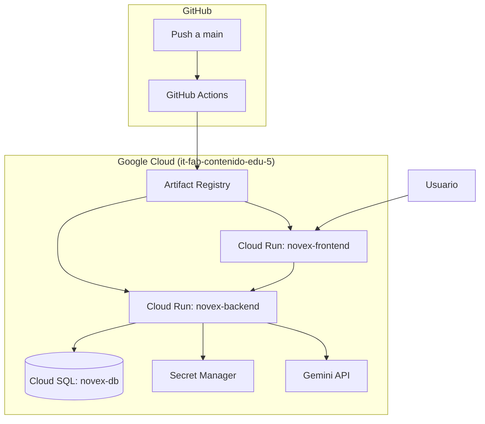
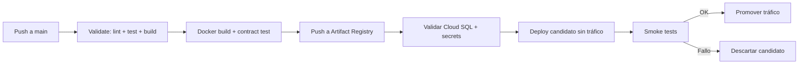

# 09 — Despliegue

[← Volver al índice](./README.md)

---

## Arquitectura de producción

NOVEX se despliega en Google Cloud Platform con dos servicios en Cloud Run, una base de datos en Cloud SQL y secretos en Secret Manager.



| Componente | Servicio GCP | Región |
|-----------|-------------|--------|
| Backend | `novex-backend` | `us-central1` |
| Frontend | `novex-frontend` | `us-central1` |
| Base de datos | `novex-db` | `us-central1` |
| Imágenes Docker | Artifact Registry (`novex/`) | `us-central1` |

**Proyecto GCP:** `it-fab-contenido-edu-5` (Operación Producto y LMS)

## Docker

### Backend

Imagen multi-stage basada en Node 20 Alpine:

1. **Builder:** instala dependencias, compila TypeScript.
2. **Runner:** copia `dist/`, ejecuta como usuario no-root `novex` en puerto 8080.

```bash
# Build local
cd NOVEX_BACKEND
docker build -t novex-backend .
```

### Frontend

Imagen multi-stage: Node 20 (build Vite) → Nginx 1.27 Alpine.

- Las variables `VITE_*` se inyectan en **tiempo de build** (no en runtime).
- `docker-entrypoint.sh` configura Nginx para escuchar en el puerto de Cloud Run (`$PORT`).

```bash
# Build local
cd NOVEX_FRONTEND
docker build \
  --build-arg VITE_GOOGLE_CLIENT_ID=... \
  --build-arg VITE_API_BASE_URL=... \
  -t novex-frontend .
```

### Desarrollo local

El backend usa Docker Compose **solo para PostgreSQL**, no para el propio backend:

```bash
cd NOVEX_BACKEND
cp .env.example .env
docker compose up -d    # Levanta PostgreSQL 17 + pgAdmin
npm run start:dev       # Backend en localhost:3001
```

```bash
cd NOVEX_FRONTEND
npm run dev             # Frontend en localhost:5173
```

## Cloud Run

### Backend (`novex-backend`)

| Parámetro | Valor |
|-----------|-------|
| CPU / RAM | 1 CPU / 1 GiB |
| Concurrencia | 40 |
| Timeout | 300 s |
| Instancias | min 0, max 5 |
| Puerto | 8080 |
| Estrategia de deploy | Blue/green con smoke tests |

### Frontend (`novex-frontend`)

| Parámetro | Valor |
|-----------|-------|
| CPU / RAM | 1 CPU / 512 MiB |
| Concurrencia | 80 |
| Timeout | 60 s |
| Puerto | 8080 (Nginx) |
| Estrategia de deploy | Directo (sin blue/green) |

### Conexión a Cloud SQL

El backend se conecta a PostgreSQL via **socket Unix**:

```
DB_HOST=/cloudsql/it-fab-contenido-edu-5:us-central1:novex-db
DB_SSL=false
```

Cloud Run monta el socket automáticamente con `--add-cloudsql-instances`.

## Secret Manager

Los secretos sensibles **nunca** van como variables de entorno planas en producción:

| Secreto en Secret Manager | Variable de entorno | Uso |
|--------------------------|-------------------|-----|
| `novex-db-password` | `DB_PASSWORD` | Contraseña de PostgreSQL |
| `novex-jwt-secret` | `JWT_SECRET` | Firma de tokens JWT |
| `novex-gemini-api-key` | `GEMINI_API_KEY` | API key de Google Gemini |

Se montan con `--set-secrets=VAR=secret-name:latest` en el deploy.

El frontend **no usa Secret Manager** — sus variables `VITE_*` son públicas y se inyectan en build time.

## Variables de entorno

### Backend — producción

| Variable | Fuente | Valor típico |
|----------|--------|-------------|
| `NODE_ENV` | Env var | `production` |
| `PORT` | Cloud Run | `8080` |
| `API_PREFIX` | Env var | `api/v1` |
| `DB_HOST` | Env var | `/cloudsql/...` |
| `DB_PORT` | Env var | `5432` |
| `DB_USERNAME` | Env var | `novex` |
| `DB_PASSWORD` | Secret Manager | — |
| `DB_DATABASE` | Env var | `novex` |
| `DB_SSL` | Env var | `false` |
| `DB_SYNCHRONIZE` | Env var | `false` |
| `JWT_SECRET` | Secret Manager | — |
| `JWT_EXPIRES_IN` | Env var | `1h` |
| `GEMINI_API_KEY` | Secret Manager | — |
| `GEMINI_MODEL` | Env var | `gemini-3-flash-preview` |
| `GOOGLE_CLIENT_ID` | Env var | OAuth client ID |
| `CATALOG_SEED_ON_BOOT` | Env var | `false` |
| `ENABLE_EMAIL_LOGIN` | Env var | `false` |

> **Nota:** `CORS_ORIGINS` se configura en deploy pero actualmente el backend usa `origin: true` (CORS abierto). Ver [12-roadmap](./12-roadmap.md).

### Frontend — build time

| Variable | Requerida | Uso |
|----------|-----------|-----|
| `VITE_GOOGLE_CLIENT_ID` | Sí | OAuth Google |
| `VITE_API_BASE_URL` | Sí | URL del backend (debe contener `novex-backend`) |

## GitHub Actions

Cada subproyecto tiene su propio workflow en `.github/workflows/`:

### Backend (`deploy-backend.yml`)

**Trigger:** push a `main` o ejecución manual.



**Smoke tests del candidato:**
- `GET /health` → 200
- `GET /health/ready` → 200 con `"database":"up"` (hasta 5 min)
- `GET /api/v1/auth/me` → 401 (sin token)

### Frontend (`deploy-frontend.yml`)

**Trigger:** push a `main` o ejecución manual.

1. Validate: lint + typecheck + test + build con `VITE_*`
2. Docker build + push
3. Deploy directo a Cloud Run
4. Smoke: `GET /` contiene `<div id="root"`, `GET /health` no devuelve HTML

### Variables requeridas en GitHub

| Variable | Backend | Frontend |
|----------|:-------:|:--------:|
| `GCP_PROJECT_ID` | ✓ | ✓ |
| `GCP_REGION` | ✓ | ✓ |
| `GCP_SERVICE_ACCOUNT_KEY` (secret) | ✓ | ✓ |
| `VITE_GOOGLE_CLIENT_ID` | — | ✓ |
| `VITE_API_BASE_URL` | — | ✓ |

> **Importante:** los workflows viven dentro de `NOVEX_BACKEND/` y `NOVEX_FRONTEND/`. Si el repositorio remoto es el monorepo padre (`Proyecto-Novex`), los workflows **no se ejecutarán** a menos que se muevan a la raíz.

## Health checks

### Backend

El backend abre un listener HTTP **antes** de que NestJS termine de cargar, para sobrevivir al cold start de Cloud Run:

| Endpoint | Tipo | Respuesta sin DB | Respuesta con DB |
|----------|------|-----------------|-----------------|
| `GET /health` | Liveness | `{"status":"ok"}` | `{"status":"ok"}` |
| `GET /health/ready` | Readiness | 503 `not_ready` | 200 con `"database":"up"` |

### Frontend

Nginx responde `GET /health` con texto plano `ok` (no pasa por la SPA).

## Deploy manual

Además de GitHub Actions, existen scripts para deploy manual:

| Script | Plataforma | Servicio |
|--------|-----------|----------|
| `NOVEX_BACKEND/scripts/deploy-backend.ps1` | Windows | novex-backend |
| `NOVEX_BACKEND/scripts/deploy-backend.sh` | Linux/Mac | novex-backend |
| `NOVEX_FRONTEND/scripts/deploy-frontend.ps1` | Windows | omega-frontend* |

\* El script manual del frontend aún usa nombres legacy `omega-*`. La fuente de verdad para CI/CD es GitHub Actions con nombres `novex-*`.

También existen configuraciones de Cloud Build (`cloudbuild.backend.yaml`, `cloudbuild.frontend.yaml`) para uso manual.

### Migraciones en producción

Las migraciones de base de datos **no se ejecutan automáticamente** en el deploy. Deben aplicarse manualmente:

```bash
# Con Cloud SQL Proxy activo
npm run migration:run
```

## Desarrollo contra Cloud SQL

Para desarrollar localmente conectado a la base de datos de producción:

```powershell
# Terminal 1: Proxy
cd NOVEX_BACKEND
npm run cloud:proxy

# Terminal 2: Backend en watch mode
npm run start:dev:cloud
```

El script `start-cloud-dev.ps1` lee la contraseña de Secret Manager automáticamente.

## Rollback

Si un deploy falla los smoke tests, el candidato se descarta y el tráfico permanece en la revisión anterior.

Para rollback manual:

```bash
gcloud run services update-traffic novex-backend \
  --to-revisions=REVISION_ANTERIOR=100 \
  --region=us-central1
```

## Inconsistencias conocidas

| Tema | Estado |
|------|--------|
| Nombres OMEGA vs NOVEX en scripts manuales | Pendiente de alineación |
| `CORS_ORIGINS` configurado pero no aplicado en código | Pendiente |
| Startup probe: CI usa `/health`, manual usa `/health/ready` | Diferencia documentada |
| Workload Identity Federation | Documentado pero no implementado (se usa JSON key) |
| Migraciones automáticas en deploy | No implementado |

## Documentación operativa detallada

Para procedimientos paso a paso, troubleshooting y creación de secretos:

- Backend: `NOVEX_BACKEND/DEPLOY_BACKEND.md`
- Frontend: `NOVEX_FRONTEND/DEPLOY_FRONTEND.md` (parcialmente desactualizado)

## Siguiente paso

- [10 — Guía para nuevos desarrolladores](./10-guia-desarrolladores.md)
- [11 — FAQ](./11-faq.md)
