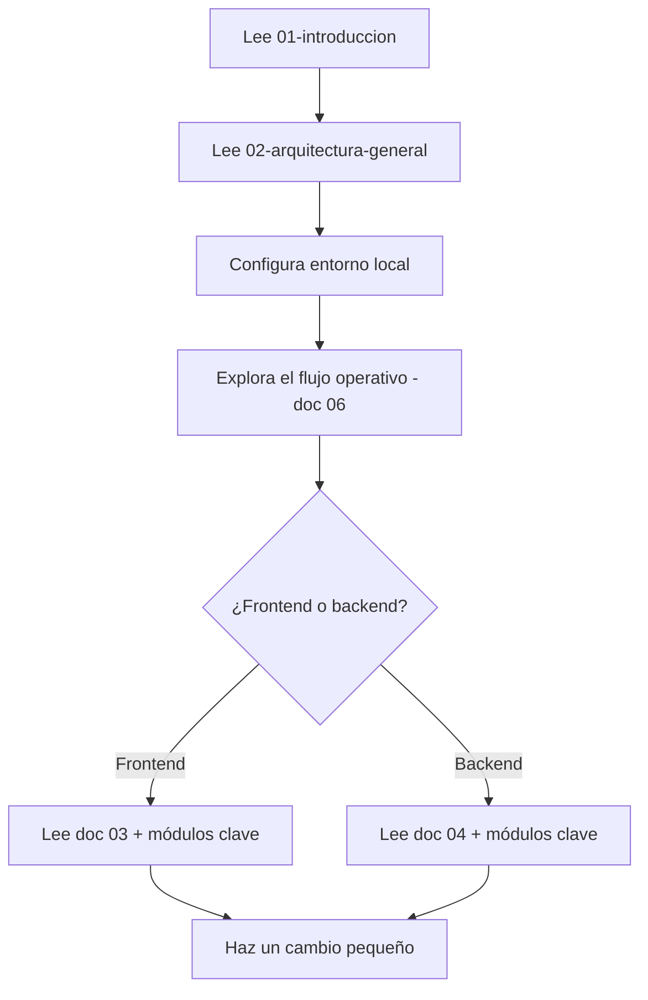
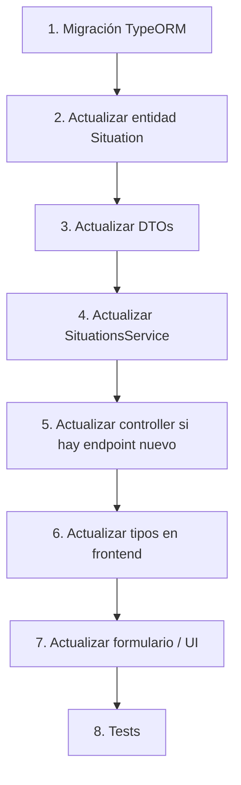

# 10 — Guía para Nuevos Desarrolladores

[← Volver al índice](./README.md)

---

## ¿Por dónde empezar?

Si acabas de llegar al proyecto, sigue este orden:



**Tiempo estimado para estar operativo:** 2–3 horas (incluyendo setup).

## Qué debes entender primero

### Conceptos que aparecen en todo el código

| Concepto en código | Significado en NOVEX |
|-------------------|---------------------|
| `operational-events` | Situaciones (nombre legacy del módulo frontend) |
| `Situation` | Entidad principal del backend |
| `NovexRoleCode` | `COORDINADOR`, `ANALISTA`, `DIRECTOR`, `ADMIN` |
| `AIAnalysisResult` | Contrato del reporte ejecutivo de IA |
| `NovexRoom` | Shell visual que envuelve todas las vistas |
| `data-tour` | Atributos HTML para el tour de onboarding |

### Dos dominios, uno activo

El backend tiene módulos legados (`operational-events`, `intelligence`) del Sprint 6–7. **Todo el trabajo nuevo va en el dominio de situaciones** (`situations`, `ai-orchestration`, etc.). No modifiques el dominio legado salvo que sea explícitamente necesario.

## Configurar el entorno local

### Requisitos

- Node.js 20+
- Docker Desktop
- npm
- Cuenta de Google (para OAuth en desarrollo)
- API key de Gemini (para probar análisis IA)

### Backend

```bash
cd NOVEX_BACKEND
cp .env.example .env
```

Edita `.env` con al menos:

| Variable | Valor local |
|----------|------------|
| `DB_HOST` | `localhost` |
| `DB_PORT` | `5432` |
| `DB_USERNAME` | `novex` |
| `DB_PASSWORD` | `novex` |
| `DB_DATABASE` | `novex` |
| `JWT_SECRET` | cualquier string largo |
| `GOOGLE_CLIENT_ID` | tu OAuth client ID |
| `GEMINI_API_KEY` | tu API key |
| `ENABLE_EMAIL_LOGIN` | `true` (opcional, para login sin Google) |

```bash
docker compose up -d       # PostgreSQL
npm install
npm run migration:run      # Aplicar migraciones
npm run start:dev          # http://localhost:3001/api/v1
```

### Frontend

```bash
cd NOVEX_FRONTEND
```

Crea un archivo `.env` en la raíz:

| Variable | Valor local |
|----------|------------|
| `VITE_GOOGLE_CLIENT_ID` | mismo que `GOOGLE_CLIENT_ID` del backend |
| `VITE_API_BASE_URL` | `http://localhost:3001/api/v1` |
| `VITE_ENABLE_EMAIL_LOGIN` | `true` (opcional) |

```bash
npm install
npm run dev                # http://localhost:5173
```

### Verificar que funciona

1. Abre `http://localhost:5173`
2. Inicia sesión (Google o email si habilitaste `ENABLE_EMAIL_LOGIN`)
3. Deberías ver la vista según tu rol

> Si no tienes usuario, el seed de desarrollo crea uno admin al arrancar el backend (si hay rol y coordinación disponibles). También puedes usar `npm run seed:operaciones` para datos de demo.

## Módulos clave para leer

### Si trabajas en frontend

Lee en este orden:

| # | Archivo / Carpeta | Por qué |
|---|-------------------|---------|
| 1 | `src/app/router.tsx` | Todas las rutas y guards |
| 2 | `src/modules/auth/context/AuthContext.tsx` | Sesión y permisos |
| 3 | `src/modules/operational-events/components/wizard/` | Flujo de registro |
| 4 | `src/modules/monitoring/components/MonitoringCenter.tsx` | Gestión de situaciones |
| 5 | `src/modules/impact-network/experience/ImpactNetworkExperience.tsx` | Red de Impacto |
| 6 | `src/modules/onboarding/onboardingTourSteps.ts` | Tour guiado |
| 7 | `src/shared/api/http.ts` | Cliente HTTP base |

### Si trabajas en backend

Lee en este orden:

| # | Archivo / Carpeta | Por qué |
|---|-------------------|---------|
| 1 | `src/app.module.ts` | Todos los módulos registrados |
| 2 | `src/auth/` | Autenticación, guards, alcance |
| 3 | `src/situations/situations.service.ts` | Lógica principal de negocio |
| 4 | `src/ai-orchestration/ai-orchestrator.service.ts` | Orquestación IA |
| 5 | `src/ai-analysis/contracts/ai-analysis-result.contract.ts` | Contrato del reporte |
| 6 | `src/permissions/seeds/permissions.catalog.seed.ts` | Permisos por rol |
| 7 | `src/configuration/env.validation.ts` | Variables requeridas |

## Cómo depurar

### Backend

```bash
npm run start:debug    # NestJS con inspector en puerto 9229
```

- Los logs de TypeORM se activan con `DB_LOGGING=true` en `.env`.
- Los health checks están en `http://localhost:3001/health` y `/health/ready`.
- Swagger no está configurado actualmente; usa los tests o consulta los controllers.

### Frontend

- React DevTools para inspeccionar contextos y estado.
- La consola del navegador muestra errores de API (el cliente HTTP loguea 401/403).
- Vitest para tests unitarios: `npm run test`
- Playwright para E2E: `npm run test:e2e`

### Base de datos

```bash
# pgAdmin incluido en docker-compose (puerto 5050)
# O directamente:
docker compose exec postgres psql -U novex -d novex
```

## Cómo agregar una nueva funcionalidad

### Ejemplo: agregar un nuevo campo a la situación



### Convenciones del proyecto

| Aspecto | Convención |
|---------|-----------|
| **Backend: módulos** | Un módulo NestJS por dominio (`situations/`, `coordinations/`) |
| **Backend: permisos** | Decorar endpoints con `@RequirePermissions('CODE')` |
| **Backend: DTOs** | Validación con `class-validator` |
| **Backend: migraciones** | Nunca usar `DB_SYNCHRONIZE=true` en producción |
| **Frontend: módulos** | Un módulo por dominio en `src/modules/` |
| **Frontend: API** | Cliente tipado en `src/modules/api/` |
| **Frontend: rutas** | Declarar en `src/app/router.tsx` con guards |
| **Frontend: permisos UI** | Usar `RequirePermissionRoute` o checks en componentes |
| **Tests** | Vitest (frontend), Jest (backend) |
| **Alias** | `@/` → `src/` en frontend |

### Checklist para un PR

- [ ] Migración de base de datos (si hay cambio de esquema)
- [ ] Permisos actualizados (si hay endpoint nuevo)
- [ ] Tipos sincronizados entre backend y frontend
- [ ] Tests para lógica de negocio
- [ ] Sin secretos en código
- [ ] Funciona en local con `docker compose up` + `npm run start:dev`

## Buenas prácticas

1. **Lee antes de escribir.** El proyecto tiene convenciones establecidas; no reinventes patrones.
2. **Dominio de situaciones primero.** No inviertas tiempo en módulos legados.
3. **Permisos desde el catálogo.** Agrega permisos en `permissions.catalog.seed.ts` y asígnalos en `ROLE_PERMISSION_CODES`.
4. **La UI no calcula negocio.** Toda lógica de negocio vive en el backend (o en hooks/servicios del frontend, nunca en componentes de presentación).
5. **No copies el schema en docs.** Explica las entidades; el código es la fuente de verdad.
6. **Prueba con roles diferentes.** Un cambio que funciona para ADMIN puede romper la vista de COORDINADOR.
7. **Onboarding es un contrato.** Si mueves un elemento con `data-tour`, actualiza los pasos del tour.

## Comandos útiles

### Backend

```bash
npm run start:dev          # Desarrollo con hot reload
npm run test               # Tests unitarios
npm run lint               # ESLint
npm run migration:run      # Aplicar migraciones
npm run migration:generate # Generar migración desde cambios de entidad
npm run seed:operaciones   # Seed de datos de demo
npm run docker:up          # PostgreSQL local
npm run docker:down        # Detener PostgreSQL
```

### Frontend

```bash
npm run dev                # Desarrollo con hot reload
npm run build              # Build de producción
npm run test               # Tests unitarios (Vitest)
npm run test:e2e           # Tests E2E (Playwright)
npm run typecheck          # Verificación de tipos
npm run lint               # Oxlint
```

## Siguiente paso

- [11 — FAQ](./11-faq.md) para respuestas rápidas
- [09 — Despliegue](./09-despliegue.md) cuando necesites publicar cambios
