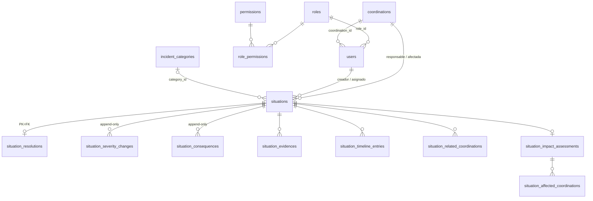

# Base de datos y migraciones

> **Propósito:** describir el modelo de datos, las 26 migraciones TypeORM, los seeds y cómo verificar y aplicar cambios de esquema sin poner en riesgo producción.
> **Revisión:** 2026-11-06 · **Código de referencia:** NOVEX_BACKEND `5ffc65f` (producción = origin/main)
> **Leyenda:** [V] verificado en código/archivo · [H] histórico/documental · [?] no verificado · [I] inferido

**Regla general:** ninguna acción que escriba en Cloud SQL (migraciones, seeds, `cloud:sql`, `cloud:user:upsert`, restauraciones) se ejecuta sin **autorización explícita**. Este documento describe; no autoriza. Ver [CLAUDE.md](../../CLAUDE.md).

---

## 1. Motor y configuración TypeORM

| Aspecto | Valor | Fuente |
|---|---|---|
| Motor en producción | PostgreSQL 16 en Cloud SQL (instancia documentada `novex-db`, `db-f1-micro`, zonal) | [H] [RELEASE_CIRCO](../RELEASE_CIRCO.md) §0, [RESTORE-TEST](../RESTORE-TEST.md) |
| Motor local | `postgres:${POSTGRES_VERSION:-17}-alpine` (por defecto 17) | [V] [docker-compose.yml](../../docker-compose.yml) |
| TypeORM | 0.3.27 | [V] `node_modules/typeorm/package.json` |
| `synchronize` | `false` siempre (runtime y CLI) | [V] [database.config.ts](../../src/configuration/database.config.ts), [data-source.ts](../../src/database/data-source.ts) |
| `migrationsRun` | `false`: la app **no** migra al arrancar | [V] ambos archivos |
| `migrationsTransactionMode` | `'each'`: una transacción por migración; permite `transaction = false` en migraciones concretas | [V] ambos archivos |
| Tabla de control | `typeorm_migrations` | [V] ambos archivos |
| Entidades | runtime: `autoLoadEntities`; CLI: glob `src/**/*.entity{.ts,.js}` | [V] |
| Reintentos de conexión | producción: 6 intentos × 3 s, timeout 15 s (por debajo de la ventana de 240 s del startup probe) | [V] [database.config.ts](../../src/configuration/database.config.ts) |
| SSL | `DB_SSL`; en Cloud Run se fuerza `DB_SSL=false` porque se usa el socket unix `/cloudsql/<instancia>` | [V] [deploy-backend.yml](../../.github/workflows/deploy-backend.yml) |

**Perfil local/cloud del CLI.** [data-source.ts](../../src/database/data-source.ts) carga `NOVEX_BACKEND/.env` (sin sobrescribir variables ya presentes) y resuelve la conexión con [resolve-database-env.ts](../../src/configuration/resolve-database-env.ts): `DB_CLOUD=true` selecciona `DB_*_CLOUD` (o `CLOUD_DB_*`), si no `DB_*_LOCAL`, con `DB_*` como respaldo [V]. **Riesgo:** `npm run migration:run` apunta a la base que diga el `.env` de la máquina; si contiene `DB_CLOUD=true`, migra Cloud SQL [I]. Comprobar el perfil antes de cualquier comando (sin imprimir el `.env`).

---

## 2. Modelo de datos (entidades)

27 entidades más una clase base ([base.entity.ts](../../src/common/entities/base.entity.ts): `id` uuid, `created_at`, `updated_at`) [V]. Tablas por módulo:

| Tabla | Entidad | Relaciones principales [V] |
|---|---|---|
| `users` | [user.entity.ts](../../src/users/entities/user.entity.ts) | N:1 `roles`; N:1 `coordinations` (nullable desde 1786100000000) |
| `roles` | [role.entity.ts](../../src/roles/entities/role.entity.ts) | 1:N `users`, 1:N `role_permissions` |
| `permissions` | [permission.entity.ts](../../src/permissions/entities/permission.entity.ts) | 1:N `role_permissions` |
| `role_permissions` | [role-permission.entity.ts](../../src/permissions/entities/role-permission.entity.ts) | N:1 `roles`, N:1 `permissions`; único `uq_role_permission` |
| `coordinations` | [coordination.entity.ts](../../src/coordinations/entities/coordination.entity.ts) | 1:N `coordination_dependencies` (origen y destino) |
| `coordination_dependencies` | [coordination-dependency.entity.ts](../../src/coordinations/entities/coordination-dependency.entity.ts) | N:1 `coordinations` ×2; único (origen, destino) |
| `situations` | [situation.entity.ts](../../src/situations/entities/situation.entity.ts) | N:1 `coordinations` (responsable `coordination_id`, afectada `affected_coordination_id`), N:1 `users` (creador, asignado), N:1 `incident_categories` (nullable desde 1787400000000); 1:N `situation_related_coordinations`; 1:1 `situation_resolutions` |
| `situation_related_coordinations` | [situation-related-coordination.entity.ts](../../src/situations/entities/situation-related-coordination.entity.ts) | N:1 `situations` (ON DELETE CASCADE), N:1 `coordinations` |
| `situation_resolutions` | [situation-resolution.entity.ts](../../src/situations/entities/situation-resolution.entity.ts) | PK = FK `situation_id` (máx. una resolución); N:1 `users` |
| `situation_severity_changes` | [situation-severity-change.entity.ts](../../src/situations/entities/situation-severity-change.entity.ts) | N:1 `situations`, N:1 `users`; **append-only por trigger** |
| `situation_consequences` | [situation-consequence.entity.ts](../../src/situations/entities/situation-consequence.entity.ts) | N:1 `situations`, N:1 `users`; **append-only por trigger** |
| `situation_evidences` | [situation-evidence.entity.ts](../../src/situation-evidence/entities/situation-evidence.entity.ts) | N:1 `situations`, N:1 `users`; único `client_key` |
| `situation_timeline_entries` | [situation-timeline-entry.entity.ts](../../src/situation-timeline/entities/situation-timeline-entry.entity.ts) | N:1 `situations`, N:1 `users`; enum `event_type` ampliado por migraciones |
| `situation_recommendations` | [situation-recommendation.entity.ts](../../src/situation-recommendations/entities/situation-recommendation.entity.ts) | N:1 `situations`, N:1 `users` |
| `situation_impact_assessments` | [situation-impact-assessment.entity.ts](../../src/situation-impact/entities/situation-impact-assessment.entity.ts) | 1:1 `situations`; 1:N `situation_affected_coordinations` |
| `situation_affected_coordinations` | [situation-affected-coordination.entity.ts](../../src/situation-impact/entities/situation-affected-coordination.entity.ts) | N:1 evaluación de impacto, N:1 `coordinations` |
| `situation_analysis_sessions` | [situation-analysis-session.entity.ts](../../src/ai-analysis-sessions/entities/situation-analysis-session.entity.ts) | `situation_id` como columna (sin decorador de relación) |
| `situation_ai_analysis_records` | [situation-ai-analysis-record.entity.ts](../../src/ai-orchestration/entities/situation-ai-analysis-record.entity.ts) | `situation_id` como columna; N:1 `situation_analysis_sessions` |
| `audit_logs` | [audit-log.entity.ts](../../src/audit/entities/audit-log.entity.ts) | sin FK; guarda `actor_user_id`, recurso y `request_id` |
| `incident_categories` | [incident-category.entity.ts](../../src/intelligence/entities/incident-category.entity.ts) | 1:N `ai_interpretations` |
| `operational_events`, `operational_timeline_entries`, `operational_areas`, `ai_interpretations` (+ tabla puente `ai_interpretation_affected_areas`), `operational_indicators`, `recommended_action_executions` | `src/operational-events/`, `src/operational-areas/`, `src/intelligence/`, `src/recommended-actions/` | Modelo de eventos operacionales anterior a «situaciones» |
| `demo_users` | [demo-user.entity.ts](../../src/demo-users/entities/demo-user.entity.ts) | sin relaciones |

Detalle de reglas de negocio de situaciones: [situaciones-y-reglas.md](situaciones-y-reglas.md). RBAC: [autenticacion-y-permisos.md](autenticacion-y-permisos.md).

---

## 3. Las 26 migraciones

Ubicación: [src/database/migrations/](../../src/database/migrations/). Tipo: **E** esquema · **D** datos/backfill · **R** RBAC · **C** compatibilidad · **IC** índice `CONCURRENTLY` (`transaction = false`). Todo [V] salvo indicación.

| # | Archivo | Tipo | Propósito | Depende de | `down()` |
|---|---|---|---|---|---|
| 1 | `1785790534246-InitialSchema` | E | Crea las 23 tablas iniciales, 17 enums, índices y FK | — | Sí, pero **borra todo** el esquema |
| 2 | `1786100000000-MakeUserCoordinationNullable` | E | `users.coordination_id` nullable | 1 | Parcial: rellena nulos con la primera coordinación (altera datos) |
| 3 | `1786400000000-AddUserOnboardingState` | E | Columnas `onboarding_*` en `users` | 1 | Sí (pierde esas columnas) |
| 4 | `1786500000000-AddSituationRelatedCoordinations` | E | Tabla `situation_related_coordinations` | 1 | Sí (pierde la tabla) |
| 5 | `1786600000000-MergeSocialLabAndAddServicios` | D | Funde `coord-social-lab` en `coord-proyeccion-social` (reasigna usuarios, situaciones, relaciones) y crea `coord-servicios`; idempotente | 1, 4 | **No real**: recrea Social Lab vacío; no deshace reasignaciones |
| 6 | `1786700000000-MakeSituationCoordinationNullable` | E | `situations.coordination_id` nullable | 1 | Parcial: rellena nulos (altera datos) |
| 7 | `1786800000000-CreateAuditLogs` | E | Tabla `audit_logs` e índices | — | Sí (pierde auditoría) |
| 8 | `1786900000000-AddSituationSlaFields` | E+D | `due_at`, `sla_policy_code`, `sla_breached_at`, `last_sla_reminder_at` con backfill; índice; `ALTER TYPE … ADD VALUE` `SLA_WARNING`/`SLA_BREACHED` | 1 | Parcial: quita columnas; **los valores de enum quedan** |
| 9 | `1787000000000-AddIncidentCategorySelectableAndIcon` | E+D | `is_selectable`, `icon` en `incident_categories`; inserta categorías | 1 | Parcial: quita columnas, no las filas |
| 10 | `1787100000000-SeedSelectableIncidentCategories` | D | Inserta (idempotente) el catálogo de 9 categorías seleccionables | 9 | Sí: borra solo las no usadas por situaciones |
| 11 | `1787200000000-AddSituationClientRequestId` | E | Columna `client_request_id` (idempotencia del alta) | 1 | Sí |
| 12 | `1787200000000-AddSituationResolutions` | E | Tabla `situation_resolutions` (PK = `situation_id`); sin backfill | 1 | Sí (pierde aprendizajes) |
| 13 | `1787200000001-CreateSituationClientRequestUniqueIndex` | IC | Índice único `uq_situations_creator_client_request` | 11 | Sí (DROP sin CONCURRENTLY) |
| 14 | `1787300000000-AddSituationAnalysisClaim` | E | `analysis_claim_token`, `analysis_claim_expires_at` (lease de análisis IA) | 1 | Sí |
| 15 | `1787300000000-GrantReportingAndClosurePermissions` | R | +`SITUATIONS_CREATE` a ADMIN y DIRECTOR, +`SITUATIONS_CLOSE` a COORDINADOR; `ON CONFLICT DO NOTHING` | 1 | Sí: quita exactamente esas 3 asignaciones |
| 16 | `1787400000000-AddSituationEvidenceClientKey` | E | Columna `situation_evidences.client_key` | 1 | Sí |
| 17 | `1787400000000-AddSituationReportKindAndAffectedCoordination` | E+D | Enum `report_kind` (INTERNAL / INTER_COORDINATION), `affected_coordination_id` (backfill = `coordination_id`), `affected_process`, `pending_delivery`; `category_id` nullable | 1 | Frágil: `SET NOT NULL` en `category_id` **falla si hay INTER** sin categoría [H] [RELEASE_CIRCO](../RELEASE_CIRCO.md) §7 |
| 18 | `1787400000001-CreateSituationEvidenceClientKeyIndex` | IC | Índice único `uq_situation_evidences_client_key` | 16 | Sí |
| 19 | `1787500000000-GrantAnalystSituationsClose` | R | +`SITUATIONS_CLOSE` a ANALISTA | 1 | Sí (solo la asignación) |
| 20 | `1787600000000-GrantDirectorKpisView` | R | Crea `KPIS_VIEW` si falta y lo asigna a DIRECTOR | 1 | Sí (solo la asignación) |
| 21 | `1787700000000-AddSituationSeverityHistory` | E | `reported_severity` (nace NULL), `severity_escalation_policy_code`, tabla `situation_severity_changes`, índices únicos parciales, función `novex_reject_append_only_update` y trigger append-only | 1 | Destructivo: borra historial y columnas |
| 22 | `1787800000000-BackfillReportedSeverity` | D | Rellena `reported_severity` (timeline → audit → `severity`), la vuelve NOT NULL e inserta una fila `REPORTED` por situación | 21 | Destructivo: borra filas REPORTED y pone `reported_severity` a NULL |
| 23 | `1787900000000-AddSituationConsequences` | E | Tabla `situation_consequences` append-only (reutiliza la función de 21); sin backfill | 21 | Destructivo (borra afectaciones) |
| 24 | `1788000000000-AddConsequenceAndEscalationTimelineEvents` | E | `ADD VALUE IF NOT EXISTS` `CONSEQUENCE_ADDED`, `SEVERITY_ESCALATED` | 1 | **Vacío a propósito** (irreversible) |
| 25 | `1788100000000-LegacySituationInsertCompatibility` | C | Triggers para que el backend anterior (`49a6483`) pueda insertar: rellena `reported_severity` y `affected_coordination_id`, y un CONSTRAINT TRIGGER diferido crea la fila REPORTED | 17, 21, 22 | Sí: solo quita triggers/funciones, no datos. **Transitoria**: retirar con una migración nueva ([RELEASE_CIRCO](../RELEASE_CIRCO.md) §9) |
| 26 | `1788200000000-RevokeAdminDirectorSituationsCreate` | R | Retira `SITUATIONS_CREATE` a ADMIN y DIRECTOR (deshace el efecto de 15) | 15 | Sí: restaura las dos asignaciones |

**Lote de la release de cartas (9 migraciones, #17 y #19–#26).** [H] [RESTORE-TEST](../RESTORE-TEST.md) registra su aplicación en una **copia restaurada** (11 s, `typeorm_migrations` 18 → 27). **No hay constancia en el repositorio de que se aplicaran en producción** [?].

### 3.1 Orden de aplicación y timestamps repetidos

- TypeORM ordena las migraciones por el timestamp del nombre de clase (`migrations.sort((a, b) => a.timestamp - b.timestamp)`) [V] `node_modules/typeorm/migration/MigrationExecutor.js`. Con el mismo timestamp, el orden depende del orden de carga (sort estable) [I]; [run-readonly-sql.mjs](../../scripts/run-readonly-sql.mjs) desempata por nombre [V].
- **Pares con timestamp compartido** [V]: `1787200000000` (ClientRequestId / Resolutions), `1787300000000` (AnalysisClaim / GrantReporting), `1787400000000` (EvidenceClientKey / ReportKind). Son independientes entre sí; los índices `…0001` dependen del primero de su par.
- TypeORM detecta pendientes **por nombre**, no por timestamp: la comprobación de «timestamp más antiguo que el último ejecutado» está comentada en esa versión [V]. Por eso en producción pudieron aplicarse primero Resolutions y GrantReporting (22-sep) y después ClientRequestId, AnalysisClaim, etc. (26-oct) [H] [INCIDENTE](../INCIDENTE-20261023-MIGRACIONES.md). El orden efectivo con este historial se ensayó en base desechable [H] [RELEASE_CIRCO](../RELEASE_CIRCO.md) §1.
- **Migración fantasma en producción:** `AllowAnalystUnassignedSituations1786500000000` figura en `typeorm_migrations` de producción y no existe en ningún commit; comparte timestamp con #4. La firma de esquema no mostró diferencias estructurales; no se puede descartar un cambio de datos [H] [INCIDENTE](../INCIDENTE-20261023-MIGRACIONES.md).
- **Aclaración del «18 + 9 = 27» frente a 26 archivos** [H]+[I]: las 18 aplicadas incluyen esa migración fantasma, es decir, 17 del repo + 1 ajena. 17 + 9 = 26 archivos; en la tabla de control quedarían 27 filas (lo que registra RESTORE-TEST). No es un archivo perdido, pero el estado real de producción sigue sin verificar.
- `migration:revert` deshace **una** migración por llamada, la última ejecutada según `typeorm_migrations` [I].

---

## 4. Requisitos y riesgos al aplicar migraciones

1. **Ningún pipeline migra.** Ni GitHub Actions ni Cloud Build ejecutan `migration:run` y `migrationsRun` es `false` [V]. El 23-oct se desplegó código que esperaba 5 columnas/índices sin aplicar → `QueryFailedError` en toda consulta de situaciones [H] [INCIDENTE](../INCIDENTE-20261023-MIGRACIONES.md).
2. **Expandir y luego desplegar.** Orden documentado: copia de Cloud SQL → `migration:show` → `migration:run` con el backend anterior sirviendo → comprobar → desplegar código [H] [RELEASE_CIRCO](../RELEASE_CIRCO.md) §3–§4, [CLAUDE.md](../../CLAUDE.md). Cada migración nueva debe ser aditiva, idempotente (`IF NOT EXISTS`, `ON CONFLICT`) y con `down()`.
3. **Índices `CONCURRENTLY`.** Deben ir en migración propia con `transaction = false` (posible por `migrationsTransactionMode: 'each'`). Si quedan `INVALID`, eliminarlos con `DROP INDEX CONCURRENTLY IF EXISTS …` y reintentar (comentario en #13 y #18) [V].
4. **`ALTER TYPE … ADD VALUE` es irreversible** y el valor no se puede usar en la misma transacción que lo crea; por eso #24 es una migración aparte con `down()` vacío [V].
5. **Backfills.** #8, #17 y #22 reescriben filas existentes; su `down()` no restaura el estado previo [V]. #22 documenta su regla de prioridad y que no inventa eventos.
6. **Triggers append-only.** `situation_severity_changes` y `situation_consequences` rechazan todo `UPDATE` [V]. Cualquier corrección de datos ahí exige una migración nueva y explícita, no un `UPDATE` manual.
7. **Revertir el lote de cartas no es viable sin pérdida de datos:** borra afectaciones, historial, severidad reportada y permisos, y se bloquea en #17 si existen INTER [H] [RELEASE_CIRCO](../RELEASE_CIRCO.md) §7. Recuperación preferida: corregir hacia delante o restaurar copia.
8. **Permisos en producción vía migración.** El seed de catálogo al arrancar está desactivado en producción, así que un cambio en `ROLE_PERMISSION_CODES` no llega solo; hace falta una migración R como #15/#19/#20/#26 [V] comentario de #15, [catalog-seed.guard.ts](../../src/configuration/catalog-seed.guard.ts).
9. **Red de oficina.** El firewall re-firma el TLS hacia Cloud SQL y el proxy lo rechaza; la vía documentada es Cloud Shell [H] [RELEASE_CIRCO](../RELEASE_CIRCO.md) §0.
10. **SQL manual fuera de TypeORM:** [migrate-intelligence-contract-version.sql](../../scripts/migrate-intelligence-contract-version.sql) hace un `UPDATE` sobre `ai_interpretations` y no queda registrado en `typeorm_migrations` [V]. Que se haya ejecutado en producción: [?].

---

## 5. Seeds

### 5.1 Al arrancar la aplicación

`CatalogSeedService` y los servicios de catálogo de coordinaciones, permisos, roles y rol-permiso (`src/database/seeds/catalog-seed.service.ts`, `src/coordinations/seeds/`, `src/permissions/seeds/`, `src/roles/seeds/`, `src/rbac/seeds/`) se ejecutan en `OnApplicationBootstrap` solo si `isCatalogSeedEnabled()`: activo por defecto fuera de producción y desactivado con `NODE_ENV=production`, con `CATALOG_SEED_ON_BOOT=true|false` como forzado [V]. El workflow fuerza `CATALOG_SEED_ON_BOOT=false` y `DEMO_SEED_ENABLED=false` [V]. `DemoSeedService` queda deshabilitado aunque se ponga `DEMO_SEED_ENABLED=true` (solo avisa) [V] [demo-seed.service.ts](../../src/database/seeds/demo-seed.service.ts).

### 5.2 Scripts npm ([package.json](../../package.json))

| Script | Qué hace | Guarda |
|---|---|---|
| `seed:operaciones` | Crea/actualiza coordinaciones y usuarios reales con rol y coordinación. Contiene datos personales: no copiarlos. **Tiene un cambio sin commit** en el working tree | `assertLocalDatabaseProfile`: rechaza perfil cloud salvo `ALLOW_CLOUD_SEED=true` [V] |
| `seed:rbac` | Reconcilia la matriz completa rol-permiso con `ROLE_PERMISSION_CODES`: **otorga y revoca** | **Ninguna** [V]. Apunta a la base que resuelva el `.env` |
| `seed:situations:mock` / `seed:situations:clear` | Genera (por defecto 80, `MOCK_SITUATIONS_COUNT`) o borra situaciones mock | `assertLocalDatabaseProfile` [V] |
| `seed:qa-director-h2[:clean]` | Escenario QA del panel Director | Más estricta: rechaza perfil cloud, host no local, SSL y `NODE_ENV=production`; no admite `ALLOW_CLOUD_SEED` [V] |
| `seed:qa-internal-vivo[:clean]` (`--report`) | Escenario QA «INTERNAL vivo» | Misma guarda que el anterior [V] |
| `sync:users:cloud[:run]` | Lee usuarios de Cloud SQL y los copia a la base local | Lee cloud, escribe local [V] |
| `cloud:user:upsert[:gcloud]` | Crea/actualiza un usuario **en Cloud SQL** (`UPSERT_USER_*`) | Ninguna; **escribe producción** [V] |
| `cloud:sql` | Ejecuta SQL arbitrario (`CLOUD_SQL` o argumento) en el perfil cloud | **Sin modo solo lectura** [V] |
| `cloud:proxy`, `cloud:psql` | Arrancan Cloud SQL Auth Proxy local (puerto 15432 por defecto) y una consola psql | Abren acceso a producción [V] |

Ninguno de estos se ejecuta contra producción sin autorización explícita ([CLAUDE.md](../../CLAUDE.md)).

---

## 6. Verificación en SOLO LECTURA (sigue requiriendo autorización)

Toda conexión a Cloud SQL, incluso de lectura, necesita autorización, credenciales y una red sin inspección TLS. Opciones existentes, de menor a mayor riesgo:

1. **[run-readonly-sql.mjs](../../scripts/run-readonly-sql.mjs)** [V]: abre la sesión con `default_transaction_read_only=on`, aborta si el servidor no lo confirma, lee la conexión de `PG*` sin imprimir la contraseña y, si el bloque `01` lista `typeorm_migrations`, compara por nombre con los archivos del repo (pendientes y «aplicadas que no están en el repo»). SQL por defecto: [release-circo-preflight-readonly.sql](../../scripts/release-circo-preflight-readonly.sql) (transacción `READ ONLY` + `ROLLBACK`, solo recuentos).
   Consulta mínima equivalente: `SELECT id, name FROM typeorm_migrations ORDER BY id;`
2. **[schema-signature-readonly.sql](../../scripts/schema-signature-readonly.sql)** [V]: firma normalizada del esquema `public` (columnas, índices, restricciones, enums, triggers, funciones) para `diff` entre dos bases. Referencias históricas: 459 líneas tras el hotfix, 509 con el lote de cartas [H] [RESTORE-TEST](../RESTORE-TEST.md).
3. **Envoltorios Cloud Shell**: [release-circo-preflight-cloudshell.sh](../../scripts/release-circo-preflight-cloudshell.sh) y [release-circo-preflight.ps1](../../scripts/release-circo-preflight.ps1) toman instancia, base y usuario de la revisión de Cloud Run que recibe tráfico [V]. Requieren `gcloud` autenticado (hoy caducado).
4. **`npm run migration:show`**: lista aplicadas/pendientes, pero usa la conexión normal de TypeORM (no forzada a solo lectura) y el perfil del `.env` [V]. Preferir la opción 1.

Fases de lectura y escritura del hotfix del 26-oct, como referencia de procedimiento: [hotfix-20261026-migraciones-main.sh](../../scripts/hotfix-20261026-migraciones-main.sh) (A lectura, B copia, C `migration:run`, D lectura, S firma) [V]. Es específico de `49a6483`; no reutilizarlo tal cual.

---

## 7. Copias de seguridad y recuperación

| Dato | Estado |
|---|---|
| Copias automáticas diarias, retención 7, PITR con 7 días de logs | [H] [BACKUP-DR](../BACKUP-DR.md), [RELEASE_CIRCO](../RELEASE_CIRCO.md) §0 (leído el 26-oct) |
| Copia bajo demanda previa al hotfix (`pre-hotfix-49a6483-…`) | [H] [INCIDENTE](../INCIDENTE-20261023-MIGRACIONES.md) |
| Restauración de esa copia en instancia aislada, RTO ≈ 16 min, instancia borrada después | [H] [RESTORE-TEST](../RESTORE-TEST.md) (26-oct) |
| Copia previa a la release de cartas (§3 de RELEASE_CIRCO) | [?] sin constancia en el repo |
| Estado actual de copias y PITR | [?] `gcloud` no disponible el 2026-11-06 |

**Contradicción documental.** [BACKUP-DR](../BACKUP-DR.md) afirma que «no se ejecutó un restore real»; [RESTORE-TEST](../RESTORE-TEST.md) y [RELEASE_CIRCO](../RELEASE_CIRCO.md) §1 registran una restauración correcta el 26-oct. El encabezado de BACKUP-DR está desactualizado [I]. Esa prueba no cubrió arrancar la app sobre la copia.

Principios documentados: restaurar **siempre a una instancia nueva**, nunca sobre `novex-db` sin aprobación; para pérdida de datos tras la release, usar la copia tomada en la ventana de despliegue, no la del hotfix [H] [RELEASE_CIRCO](../RELEASE_CIRCO.md) §7. Procedimiento: [RESTORE-TEST](../RESTORE-TEST.md) y [restore-test-cloudshell.sh](../../scripts/restore-test-cloudshell.sh). Todo ello **requiere autorización explícita**.

---

## Límites de verificación

- No se conectó a ninguna base. **Las migraciones aplicadas en producción no están verificadas**; la última lectura documentada es del 26-oct (18 filas).
- `GET /health/ready` con `database: up` (2026-11-06) prueba conectividad (`SELECT 1`), no el esquema.
- Estado de copias, PITR e instancia: sin verificar (`gcloud` requiere reautenticación).
- El orden de carga entre migraciones con el mismo timestamp se infiere de TypeORM; se ensayó en base desechable [H], no se reprodujo aquí.
- No se leyó el `.env` local; se desconoce a qué perfil apunta.
- Relaciones de entidades leídas por decoradores; no se contrastaron una a una con las FK de la base.

## Documentos relacionados

- [README.md](README.md) · [arquitectura.md](arquitectura.md) · [situaciones-y-reglas.md](situaciones-y-reglas.md) · [autenticacion-y-permisos.md](autenticacion-y-permisos.md) · [seguridad-y-correcciones.md](seguridad-y-correcciones.md) · [inteligencia-artificial.md](inteligencia-artificial.md) · [despliegue-y-operacion.md](despliegue-y-operacion.md) · [pruebas-y-desarrollo.md](pruebas-y-desarrollo.md)
- [CLAUDE.md](../../CLAUDE.md) · [DEPLOY_BACKEND](../../DEPLOY_BACKEND.md) §17 · [RELEASE_CIRCO](../RELEASE_CIRCO.md) · [INCIDENTE 23-oct](../INCIDENTE-20261023-MIGRACIONES.md) · [RESTORE-TEST](../RESTORE-TEST.md) · [BACKUP-DR](../BACKUP-DR.md)
- Frontend: NOVEX_FRONTEND → `docs/empalme/pruebas-y-desarrollo.md`
